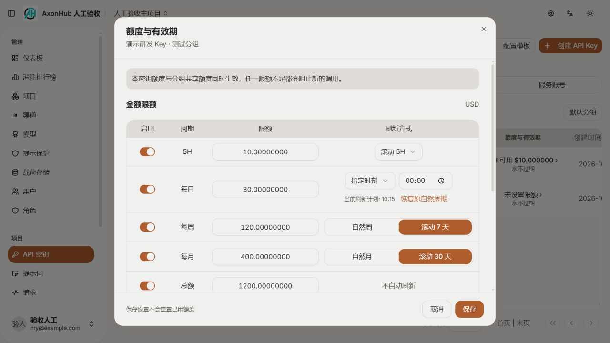
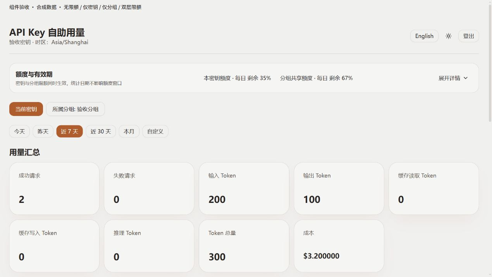
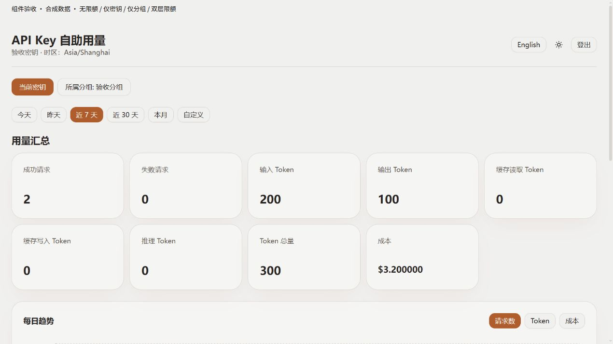
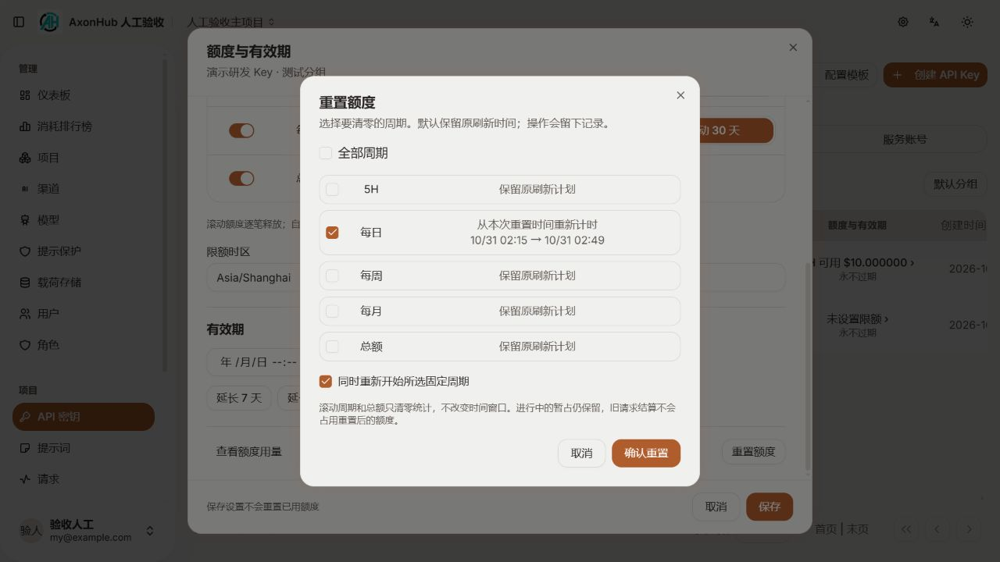

# 密钥与分组额度：实现与验证记录

状态：确认范围的功能已实现，完成本地定向验收及独立复审，尚未提交或发布。日期：2026-10-30。

交付代码位于 `F:/GitProject/axon-hub`。本记录区分功能实现、本地验证与未覆盖环境，不将设计预览作为运行证据。

## 功能结果

- 密钥和分组分别支持 5H、每日、每周、每月、总额；所有已启用窗口同时约束请求。周/月分别可选自然周期或滚动 7/30 天。
- 每个窗口都能手动重置，默认保留刷新计划；固定周期可选择重新开始，并在确认前对比原、新刷新时间。滚动窗口与总额不提供虚假的周期重启。
- 额度、周期、到期时间独立管理；调整上限或续期不清零。首次启用前显示记账边界，重新启用保留账目。
- 请求发送前在数据库事务内同时预占 Key/Group 余额。实际费用按原归属结算一次；重试的不同执行分别记账；未知结果保留占用，未发送的请求可释放。
- 图片报价使用最终请求数量；显式零价不被当成缺价。已有 Usage 的异常流仍结算已知费用，保持请求失败状态。
- 视频任务保存独立任务标识、协议和当时的价格。日志缺失或备份恢复后仍可查询终态；任务已创建后的本地持久化失败停止换渠道重发。
- 独立预算账目不依赖用量日志保留。备份格式升级至 1.5，同时保存账户、占用、费用事件、重置版本、周期锚点与审计。
- 管理页列表直接展示“额度与有效期”，行菜单、编辑页、创建成功详情和分组管理复用同一设置弹窗。创建说明明确：先创建，再在详情继续设置；分组限制立即生效。
- 原配置档案仍兼容，文案改为“当前配置附加配额”，说明新版入口，避免再次误认旧配额表单。
- 分组筛选选中即生效，不再要求“应用”；默认分组偏好仍显式保存。
- 自助页默认只有紧凑摘要，支持展开/收起；无限额整块隐藏，仅一层有限额就只展示该层。额度表头与条目共用列定义并居中。

## 生效例子

某密钥可用 4，所在分组可用 10。一次请求预计 3，必须同时取得两边的占用，其他请求此时看到可用分别为 1 和 7。若最终费用是 2，两边各结算 2、释放预计占用，余额分别成为 2 和 8。这里是同一笔费用被两层限制检查，并非向供应商付两次费用。组内其他密钥共享剩余 8；自己的个人上限仍另外检查。任一有效窗口不足或任一对象到期，新的调用就不能通过。

## 代码导航

| 范围 | 实现 |
| --- | --- |
| 金额、时间窗口、重置 | `internal/pkg/budget/`（new） |
| 独立账表与生成代码 | `internal/ent/schema/budget_*.go`（new）及对应 Ent 生成文件 |
| 准入、结算、恢复、管理接口 | `internal/server/biz/budget_*.go`（new）、`usage_log.go`、`video.go`、`auth.go` |
| 请求实际发送与重试 | `internal/server/orchestrator/budget.go`（new）、`outbound.go`、`request.go` |
| 管理与自助 GraphQL | `internal/server/gql/budget*.graphql`（new）、`budget.resolvers.go`（new）、`selfusage/` |
| 备份恢复 | `internal/server/backup/budget.go`（new）、`types.go`、`restore.go`、`backup_ops.go` |
| 设置、摘要、重置与明细 | `frontend/src/features/budgets/`（new） |
| 自助收起/隐藏及分组筛选 | `frontend/src/features/self-usage/components/budgets.tsx`（new）、`apikeys/components/key-group-controls.tsx` |
| 中文/英文文案 | 两种语言的 `budgets.json`（new）及 `apikeys.json` |

## 已执行验证

1. 最终后端相关包整包回归通过：

   ```text
   go test ./internal/pkg/budget ./internal/server/biz ./internal/server/orchestrator ./internal/server/backup ./internal/server/gql ./internal/server/gql/selfusage ./internal/server/db -count=1
   ```

   覆盖金额精度、DST/月末、重置默认与周期重启、恢复自然日程、原子预占、延迟结算、初次启用边界、项目权限、100 个并发争用组内 10 个额度、图片最终数量、零价、过期认证、异常流结算和旧 schema 升级等。

2. 备份与故障专项通过：

   - Key/Group 已用与在途金额往返；删除项目后不复活旧分组，也不把旧账绑定新 Key。
   - 已持久实际费用在无请求日志时恢复；重复核对只入账一次。
   - 视频 queued → 备份恢复 → completed，真实请求发送到本机 httptest 服务；未完成保留 3，完成结算 2、释放占用，重复核对仍只有一笔费用事件。
   - 已完成视频在无原渠道的目标恢复成功。
   - 注入视频任务标识持久化失败，提供两个候选，实际 executor 调用次数仍为 1。
   - 已有预算历史目标拒绝覆盖并回滚；不一致占用快照拒绝导入。

3. 自助 GraphQL 当前 Key/Group 隔离、别名重复查询限制通过。前端 7 项现有定向测试通过：

   ```text
   node --test src/features/apikeys/default-groups.test.mjs src/features/self-usage/session.test.mjs src/features/self-usage/scope.test.mjs
   ```

4. 前端修改文件完成定向 Prettier。执行 `tsc -p tsconfig.app.json --noEmit --pretty false`：整个项目仍报告 172 项存量错误；本轮修改文件筛选未检出错误，不能据此称全量类型检查通过。没有执行 lint/build。一次 `pnpm exec prettier` 因其自动依赖检查试图重装依赖而失败，未强制安装或清空依赖；随后直接运行项目已安装的同一 Prettier 成功。

5. 内置浏览器对本机真实管理接口验证：五窗口保存回读、组滚动周保存、分组立即筛选、默认保留周期的重置、可选周期重启及刷新时间预览。自助页四种显示状态使用**真实 React 组件与隔离合成数据**验证，没有读取或复制现有 Key。内置浏览器未接管用量按钮的弹出标签页，因此不将这部分称为真实登录端到端验收；自助后端由独立 GraphQL 测试覆盖。

6. 独立 `gpt-6.1-sol / max` 多轮只读审查；发现的主线问题已修复。最后一轮独立执行 5 项定向回归、4 个包通过，未发现新的阻断。

7. `git diff --check` 无空白错误。新增和明显增长的手写 Go/TSX 文件均未超过 2200 行；生成代码不按手写模块拆分。

## 实际界面

管理设置截图来自本机真实服务：



自助页面以下截图来自实际页面组件与合成数据，展示布局和显隐行为，不表示线上用量：





## 升级、恢复与验证边界

- 已复核发布清单的直接上游 `b205ae8eb0db9fed6078e3a5c624bda61b36de31`，没有同名 budget schema。通过 Ent 创建独立新表，不新增或修改已发布 data migration；旧密钥、分组和档案维持原状。
- 含预算恢复使用一致快照，不把进行中占用清零。目标同一对象已有预算账目时拒绝混合恢复，需要空预算目标；新功能未发布，不设计未经授权的历史账目合并。
- 未完成视频若仍需上游结果，恢复目标必须有对应渠道；已有确定费用或已结算记录不依赖渠道。已删除渠道且结果未知的记录保留占用，不伪造免费结算。
- 恢复后的负 owner/project/execution ID 是独立历史标识，不指向活实体；负 actor ID 表示来源实例操作者，不冒充目标用户。
- 未执行真实 PostgreSQL/MySQL/TiDB 实例验证、多进程压力测试或真实收费供应商调用，也没有宣称绝对硬上限或吞吐指标。实际费用超过预估时完整入账，后续请求受剩余额度约束。
- 本机内置浏览器存在外部时区覆盖：它把传给 `Intl.DateTimeFormat` 的显式 `Asia/Shanghai` 改成 `UTC`。DOM 时间值与后端时区正确，但日期显示受该环境影响；未擅自修改浏览器设置。后端时区和 DST 由测试验证。
- 本轮本机数据库的演示设置保留用于以后人工验收；前后端及临时组件服务在验证后关闭，生产部署未变。
- 应用当前绑定的 `C:/Users/xiaowei/.codex/worktrees/budget-codegen/axon-hub` 是早期代码生成用工作树，完整交付仍在上文 F: 路径。受管归档接口返回“当前任务主 checkout 不可移除”，因此保留，未绕过接口删除或覆盖。

## 收尾状态

最终代码干净重启后，编辑页进入同一额度弹窗成功，已保存周限额正确回读，重启后未出现新的页面错误。本轮启动的 8090、5173、5174 服务全部关闭，确认无监听；两个受管 verification-scratch 任务目录均由固定清理脚本清理成功，未删除其他任务目录。

## 追加独立阶段复审（2026-10-30）

按用户要求重新启动独立 `gpt-6.1-sol / max` 代理，只读核对确认方案、实际实现与验证记录。未发现新的后端扣费安全阻断；本次发现并修复的差异如下，均属于既定计划，不扩展到其他模块治理。

- 新对象默认时区原为 UTC，与沿用系统时区的计划不符。现在管理与自助视图从同一 SystemService 取得时区；已保存规则不随系统设置变化。空账户首次重置预览和提交使用相同默认时区。APIKeyService 增加必要的 SystemService 注入，直接调用与测试同步。
- 补齐自然 1 个月、3 个月、1 年快捷续期，保留原来的 7/30/90 天。按当前时间与原到期时间较晚者起算，目标月份不存在的日期取月底，保持所标示时区的本地时刻。
- 重置弹窗只选滚动周期或总额时，禁用“同时重新开始周期”；加入固定周期后才可选择。预览和提交使用同一有效开关，未选中的窗口不会显示“重新开始”。

新增 `frontend/src/features/budgets/expiry.ts`、`expiry.test.mjs`，4 项日期回归覆盖月末、闰年、到期起算和夏令时。新增后端用例 `TestBudgetInitialTimezoneUsesSystemAndKeepsSavedCalendar`、`TestBudgetMixedKeyTypesUseTheSameGroupLimit` 均通过；后者通过真实 CreateAPIKey 接口创建 user/personal/service_account 同组，两个类型各结算 0.4 后，第三个不能突破组总额度 1。原有跨项目和管理员赋组检查仍保留。

本次复核命令：

```text
go test ./internal/server/biz ./internal/server/gql ./internal/server/gql/selfusage ./internal/server/orchestrator -count=1
node --test src/features/budgets/expiry.test.mjs
tsc -p tsconfig.app.json --noEmit --pretty false
git diff --check
```

四个 Go 包整包回归、四项前端日期测试、修改文件格式与差异检查通过。全量 TypeScript 仍有 172 项存量错误，本次文件未检出错误。独立代理另行执行预算五包定向回归及最终增量测试，均通过。真实数据库方言、压力和供应商验证边界保持不变。

浏览器复核只使用后台标签页和只读重置预览：滚动周期禁用重启、选定固定周期后可用、取消固定周期后恢复禁用、自然月年按钮存在、提示范围正确。没有提交新的重置、续期或额度修改。后端已重启加载修正；8090/5173 继续运行，原人工验收标签页保留。


