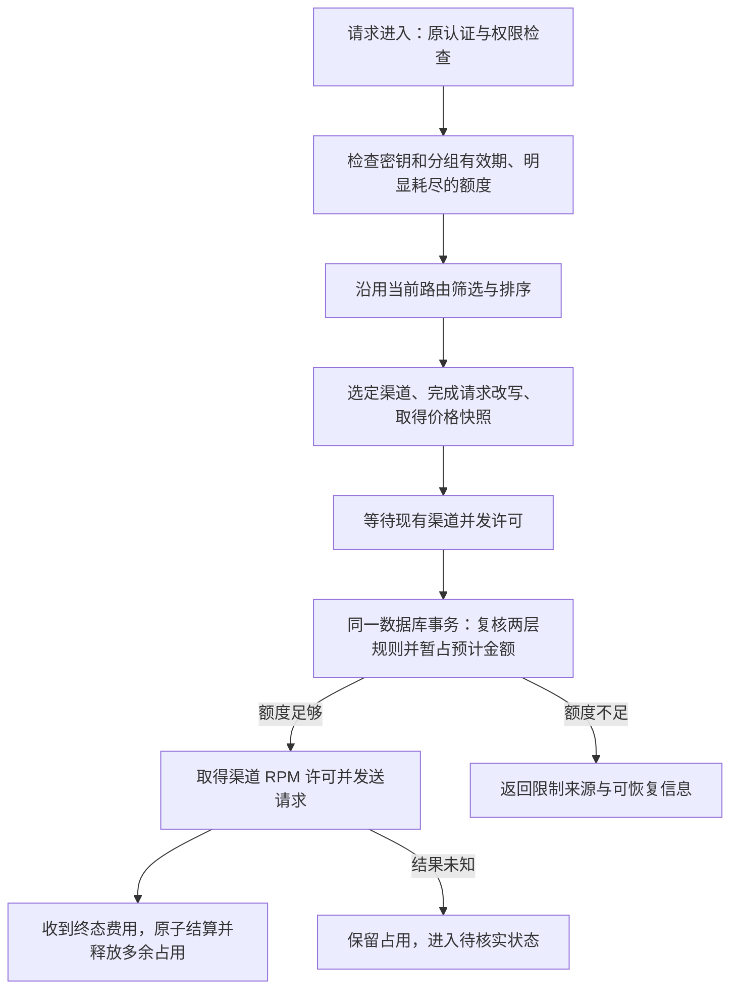

# API 密钥与密钥分组限额：需求与推荐方案

> 状态：确认功能已实现并完成本地定向验收及独立复审，未发布；环境覆盖和限制见[实现验证记录](api-key-group-budgets-implementation.md)。
> 调研日期：2026-10-29；2026-10-30 复核 CCH 周/月语义，补充手动重置的周期选项，以及本项目每周/每月的滚动模式要求。
> 入口：[中文文档](../zh/index.md) · [英文文档](../en/index.md)。
> 范围：复刻 CCH 的金额限额、周期刷新、重置和有效期体验，并扩展到 AxonHub 的密钥分组；本文是待实施方案。
> 视觉预览：[最终图片与交互说明](../../output/design/axon-key-budgets-20261030/README.md)。

## 1. 结论

当前 AxonHub **已有配额，但入口在密钥的配置档案中**：点击密钥列表里的生效配置，展开配置，找到“配额”。每个档案只有一个统计周期，可限制请求次数、Token 或费用；运行时只检查当前生效档案。它不能同时表达“5H、每日、每周、每月、总额”五道金额限制，也没有密钥有效期和分组共享额度。

推荐新增密钥与分组自身的预算设置，五种限额同时生效。每周可选自然周或滚动过去 7 天，每月可选自然月或滚动过去 30 天；密钥和分组分别配置。分组是一份由所有成员共同消费的预算；密钥自身还可以有更小的限制。切换配置、换渠道、轮换密钥字符串，都不能重置这两层预算。

推荐实现为：**数据库保存预算账目；请求发出前，在一次短事务中同时检查并暂占密钥、分组的额度；结束后按实际费用结算；刷新与到期由当前时间决定。** 后台任务只处理未完成结算和历史数据维护，不承担“到点才清零”的正确性责任。Redis 可用于展示缓存，不作为首版预算判断的权威来源。

这是基于当前项目的推荐：AxonHub 默认 SQLite、内存缓存，已有多数据库支持与费用快照。该方案兼顾分组并发、进程重启和现有部署方式。它比单纯增加表单字段工作量大，也会增加数据库短事务；是否需要更复杂的高吞吐方案，应由真实负载验证决定。

## 2. 调研依据与当前缺口

### 2.1 核对的版本

| 对象 | 本次基线 | 说明 |
| --- | --- | --- |
| AxonHub | `6f8862b0145182d6521e5d4a702791d38d4ae33a` | 已含“API 密钥分组与分组用量统计”；以本地当前源码为准 |
| CCH | `0c508eaac7e1f3c3717eb6a965b466e719f92b1e`，版本文件同步到 `v0.9.8` | 本地源码只读调研，不声称这是远端最新版本 |
| AxonHub 直接上游 | `ChouUn/axon-hub` 的 `v1.0.0-beta10-fork.7` / `b205ae8e` | 来源为 `release.config.json` |
| 原始上游 | `looplj/axonhub` 的 `v1.0.0-beta10` / `939b2bc0` | 与直接上游分别追踪 |

没有读取真实密钥、用户账单、生产数据库或服务凭据。“迁移复刻”在本轮指功能与交互迁移，不包含将 CCH 账户、密钥或历史数据导入 AxonHub。

### 2.2 AxonHub 已核实的行为

| 能力 | 当前实现 | 本次需要补齐 |
| --- | --- | --- |
| 密钥配额 | `APIKeyProfile.Quota` 包含请求数、Token、费用及一个周期 | 独立于档案的五种金额限额，同时校验 |
| 周期 | 总量、过去 N 分钟/小时/天、自然日/月 | 五窗口同时生效；5H 固定/滚动、每日指定时刻/滚动、每周自然周/滚动 7 天、每月自然月/滚动 30 天 |
| 校验 | `enforceQuota` 查询当前档案，`QuotaService` 汇总 `usage_logs` | 密钥与分组一起校验，在途请求占用也参与判断 |
| 有效期 | `APIKey` 无到期字段；启用、禁用、归档由状态控制 | 到期时间、剩余有效期、快捷续期 |
| 分组 | `APIKeyGroup` 只有名称、项目归属等基础字段 | 共享金额限额、有效期、刷新、独立重置 |
| 分组统计 | 按密钥**当前**所属分组汇总历史消费 | 预算按请求当时的分组记账，移组不挪动已经消耗的额度 |
| 成本 | 请求执行保存价格与倍率快照，费用可为空 | 复用快照；明确缺价格、缺用量时不能按免费处理 |
| 持久化 | 用量日志可以被 GC 清理 | 总额与预算账目不能随请求日志清理而消失 |

源码依据：

- [配额类型](../../internal/objects/apikey.go)、[配额服务](../../internal/server/biz/quota.go)、[入口校验](../../internal/server/orchestrator/quota.go)。
- [配置弹窗](../../frontend/src/features/apikeys/components/apikeys-profiles-dialog.tsx)、[列表中的配置入口](../../frontend/src/features/apikeys/components/apikeys-columns.tsx)。
- [密钥 schema](../../internal/ent/schema/api_key.go)、[分组 schema](../../internal/ent/schema/api_key_group.go)、[分组管理](../../internal/server/biz/api_key_group.go)、[按当前成员关系查询报表](../../internal/server/biz/consumption_query.go)。
- [费用快照](../../internal/server/biz/request_cost_snapshot.go)、[用量日志写入](../../internal/server/biz/usage_log.go)、[日志清理](../../internal/server/gc/gc.go)。

这里描述的是源码行为，未查询任何具体密钥的已配置额度。不能据此断言当前所有密钥都没有限制。

### 2.3 CCH 可复刻的行为

| 功能 | CCH 当前源码行为 | AxonHub 目标 |
| --- | --- | --- |
| 5H | 默认滚动过去 5 小时；可选固定窗口 | 两种均支持，密钥和分组分别配置 |
| 固定 5H | 首次成功记账创建 5 小时窗口；到期后重新开始 | 保留该语义；窗口起点持久化，不依赖 Redis 是否仍有缓存 |
| 每日 | 默认固定 `00:00`；可改 `HH:mm`；也可选滚动 24 小时 | 完整支持，明确显示时区 |
| 每周 | 系统时区的周一 `00:00` 到下周一 | 默认自然周，另可选滚动过去 7 天；有固定边界时手动重置可保留或重新计周期 |
| 每月 | 系统时区每月 1 日 `00:00` 到下月 1 日 | 默认自然月，另可选滚动过去 30 天；自然月与滚动 30 天明确区分 |
| 总限额 | 无自动刷新；从有效费用重置边界累计 | 无自动刷新，与周期限额并行 |
| 额度重置 | Key 的 `resetKeyLimitsOnly` 更新 `costResetAt`，清理各周期费用缓存，保留历史账单，并非仅处理总额 | 五项都支持手动重置；进一步允许选单项/全部，默认保留周期，可选同时重置周期 |
| 到期 | Key、User 均有 `expiresAt`，认证时检查 | Key、Group 均有到期时间，两者任一到期阻止新的付费调用 |
| 快捷日期 | 创建时有 1 周、1 月、3 月、1 年；续期有 7/30/90 天、自定义日期 | 复刻入口，保留“自然月”与“天数”的区别 |
| 快捷续期 | 以当前时间与原到期时间较晚者为基准；可选择重新启用 | 同样支持；续期不重置费用，不默认取消人工禁用 |
| 用量展示 | 当前金额、限额、窗口方式、刷新信息 | 加上分组约束、进行中占用、实际限制来源 |

**“7 天 / 30 天”需要按入口区分。** CCH 的[供应商使用指南文案](https://github.com/ding113/claude-code-hub/blob/0c508eaac7e1f3c3717eb6a965b466e719f92b1e/messages/zh-CN/settings/providers/guide.json)确实把消费限额写成“5 小时、7 天、30 天”；快捷续期也有 7/30/90 天，统计页还有近 7/30 天。这些文字不能证明额度提供滚动 7/30 天选项：本地该版本 `time-utils.ts` 的 `weekly` 使用周一边界，`monthly` 使用月初边界，`limit-rule-picker.tsx` 只有 5H 和每日提供固定/滚动选择。这里以实际执行代码说明额度行为，不把界面概述中的天数误当成可选周期。

CCH 还包含 User、Provider 额度、RPM 和并发会话限制。这些不是 AxonHub 新密钥分组的同义对象；本次不增加账户体系或复制整套限流功能。分组共享预算借鉴 CCH 的上层共享约束，但沿用 AxonHub 已有项目、权限、成员关系。

CCH 源码证据均固定到上述提交：

- [Key 字段](https://github.com/ding113/claude-code-hub/blob/0c508eaac7e1f3c3717eb6a965b466e719f92b1e/src/types/key.ts)、[时间窗口](https://github.com/ding113/claude-code-hub/blob/0c508eaac7e1f3c3717eb6a965b466e719f92b1e/src/lib/rate-limit/time-utils.ts)。
- [费用校验与固定 5H 记账](https://github.com/ding113/claude-code-hub/blob/0c508eaac7e1f3c3717eb6a965b466e719f92b1e/src/lib/rate-limit/service.ts)、[请求校验顺序](https://github.com/ding113/claude-code-hub/blob/0c508eaac7e1f3c3717eb6a965b466e719f92b1e/src/app/v1/_lib/proxy/rate-limit-guard.ts)。
- [重置及续期](https://github.com/ding113/claude-code-hub/blob/0c508eaac7e1f3c3717eb6a965b466e719f92b1e/src/actions/keys.ts)、[费用重置边界](https://github.com/ding113/claude-code-hub/blob/0c508eaac7e1f3c3717eb6a965b466e719f92b1e/src/lib/rate-limit/cost-reset-utils.ts)。
- [额度缓存实现](https://github.com/ding113/claude-code-hub/blob/0c508eaac7e1f3c3717eb6a965b466e719f92b1e/src/lib/rate-limit/lease-service.ts)、[数据库费用汇总](https://github.com/ding113/claude-code-hub/blob/0c508eaac7e1f3c3717eb6a965b466e719f92b1e/src/repository/statistics.ts)。
- [快捷续期交互](https://github.com/ding113/claude-code-hub/blob/0c508eaac7e1f3c3717eb6a965b466e719f92b1e/src/app/%5Blocale%5D/dashboard/_components/user/forms/quick-renew-key-dialog.tsx)、[创建时的快捷日期](https://github.com/ding113/claude-code-hub/blob/0c508eaac7e1f3c3717eb6a965b466e719f92b1e/src/app/%5Blocale%5D/dashboard/_components/user/forms/quick-expire-picker.tsx)。

### 2.4 复刻与项目适配的边界

五种金额窗口、CCH 已有刷新模式、到期与续期属于复刻范围。每周滚动 7 天、每月滚动 30 天是用户明确要求的本项目扩展，不受 CCH 当前能力限制。以下区分已明确的扩展需求与其余推荐适配，均不能冒充 CCH 原样行为或已经实现：

| 适配选择 | 推荐理由 | 代价 |
| --- | --- | --- |
| 周/月增加滚动模式，密钥与组均可独立选择 | 用户已明确要求，不必只按周一/月初划分额度 | 最长查询和保留窗口扩展到 30 天，需要验证较大用量下的查询性能 |
| Key 与 Group 独立重置，不沿用 User 重置向 Key 传播 | 分组共享额度与成员个人额度职责独立 | 若要两层同时重置，需明确选择两个范围 |
| 首次启用从明确起点计账，不自动重建全部历史 | 旧分组没有请求时归属，日志也可能已被清理 | 新“总额”不等于密钥创建以来所有消费，界面必须标明起点 |
| 窗口模式/时刻修改默认下轮生效 | 避免改规则无意获得一份新额度 | 立即生效需要显式选择重置该窗口 |
| 手动重置默认保留周期，可选重新开始周期 | 用户已明确要求：恢复额度不应默认推迟下一次刷新 | 必须分别保存额度重置版本与周期边界，不能简单删除窗口状态 |
| 费用预占与持久账目替代仅检查缓存后事后扣费 | 降低组内并发超额，恢复时不遗忘用量 | 更多短事务；仍需明确预估误差，不能承诺绝对不超支 |

## 3. 需求清单

以下为已确认的目标行为；实现状态见第 9 节，不将纯计算模块通过测试等同于功能已接入。

| 编号 | 需求 | 可验收结果 |
| --- | --- | --- |
| B01 | 密钥配置 5H、每日、每周、每月、总金额限额 | 可同时保存五项，任意一项不足都不能继续发起需要该额度的请求 |
| B02 | 分组具备完全相同的五项配置 | 组内所有密钥共享一份余额，不是把组额度复制给每个成员 |
| B03 | 两层同时生效 | 密钥未设限仍受分组限制；分组未设限仍受密钥限制；无分组只校验密钥 |
| B04 | 刷新模式 | 5H 固定/滚动、每日指定时刻/滚动 24H、每周自然周/滚动 7 天、每月自然月/滚动 30 天；各项独立选择，密钥与组均支持；总额不自动刷新 |
| B05 | 展示额度与恢复时间 | 区分已结算、进行中占用、可用、下次变化及是否可自动恢复 |
| B06 | 手动重置额度 | 五种限额均支持单项或全部重置；保留账单；密钥与组分别处理；默认不改变原周期 |
| B07 | 密钥、分组有效期 | 永不过期、日期/时间、快捷日期、续期；任一到期阻止新的付费调用 |
| B08 | 直观入口 | 创建/编辑可设置；列表有摘要与“额度与有效期”；分组管理复用相同编辑内容 |
| B09 | 自助查询 | 密钥使用者能看到自己的额度、当前组的共享可用额度及阻止原因，不能修改预算 |
| B10 | 并发与重复结算正确 | 两个成员竞争组内最后额度时不会各自拿到完整余额；同一结算事件不能重复扣费 |
| B11 | 重启、清缓存、清日志不恢复额度 | 预算账目、窗口锚点、重置边界、在途占用均可恢复 |
| B12 | 移组、删组、轮换不篡改历史 | 历史消费保留原归属，轮换字符串沿用密钥 ID 与余额 |
| B13 | 各调用方式覆盖一致 | HTTP、流式、透传、Responses WebSocket 使用相同预算服务；异步任务独立覆盖提交/完成路径 |
| B14 | 权限与修改可追踪 | 跨项目拒绝；预算变更、到期修改、重置、未知占用处理记录操作者与影响范围 |
| B15 | 与现有能力共存 | 现有档案配额、路由优先级、渠道限流、健康门控继续生效，新预算不能扩大原权限 |
| B16 | 周期可随手动重置重新开始 | 对有固定刷新边界的窗口提供“同时重置周期”，默认关闭；开启后从操作时刻开始新周期，并显示新的刷新时间 |
| B17 | 表头与条目逐列居中 | 密钥列表、额度表单、用量表和重置表的标题与内容共用列中心；金额、开关及周期控件不能逐行左右漂移；长说明在本列内换行 |

### 3.1 金额与有效限制

限额使用模型价格和历史 `total_cost` 的同一记账单位，默认使用场景为 USD。系统 `currency_code` 当前只是展示设置，不提供汇率换算；不能通过更换货币符号改变数值含义。若以后导入 CCH 的 USD 额度，必须先确认单价采用同一单位。

新字段推荐用 `null` 表示不限额；界面以开关明确表达，不要求用户猜测空值和零。为对齐 CCH，新预算接口将 `0` 规范为不限额、拒绝负数。既有 `APIKeyProfile.Quota.cost = 0` 的行为单独保持，不用新规则重新解释旧字段。

**示例，非真实账单：** 分组每日 100，成员 A 每日 30、成员 B 每日 80。A 已用 25，B 已用 70，组内只剩 5。A 自身剩 5、B 自身剩 10，但两者合起来只能再占用组内的 5；不能各拿 5。若月额度已耗尽，即使每日刚刷新也不能调用。

所有限制取交集，不存在“密钥优先覆盖组额度”。修改金额只改变上限，不隐含清零；把上限降到已用金额以下后立即阻止后续请求。周期上限不必强制按大小排列，例如每月上限小于每周上限仍有明确含义。

### 3.2 刷新时间的精确定义

- **滚动 5H/24H/7 天/30 天：** 分别统计过去 5、24、168、720 小时的费用，按实际经过的时长计算，不因时区或夏令时改变窗口长度。每笔费用在入账经过对应时长后逐步移出，没有一个全量清零时刻；滚动 30 天也不是从启用时间开始、每隔 30 天整批刷新。界面明确写“过去 7 天”“过去 30 天”“下一笔额度释放”，不能显示为周一/月初清零。
- **固定 5H：** 正常情况下，该对象本轮第一笔正费用成功入账时开始计时，之后到同一截止时刻刷新；后续请求不能延长窗口。仅暂占、未实际产生费用的请求不启动窗口。刷新后空闲期间不循环创建空窗口。手动勾选“同时重置周期”时例外：立即以操作时间建立新的 5H 窗口，不等待下一笔费用。
- **固定每日：** 以指定时区的 `HH:mm` 划分自然日。每日 18:00 的窗口是前一日 18:00 到本日 18:00，不是从第一次使用起 24 小时。
- **每周/月的自然周期模式：** 默认按周一/每月 1 日的 00:00 划界，使用日历运算，不能用固定秒数代替自然月或有夏令时地区的自然日。若明确选择让周期随手动重置重新开始，则改用该次操作建立的周期起点，按 3.3 节计算并展示实际边界。选择滚动模式后不再使用上述自然边界。
- **总额：** 从预算记账起点或最近一次总额重置开始累计，没有自动恢复时间。
- **时间基准：** 预算首次启用时从 `SystemService.TimeLocation` 取得时区并保存，后端统一计算 UTC 边界。系统时区或浏览器时区后来变化不暗中挪动现有预算边界；需要改预算时区时按下面的规则变更流程处理。

新增预算账目统一以**费用事件首次成功入账的时间**划分周期，另存请求发出时间供追溯。重复入账不能更新这个时间。请求在午夜前发出、午夜后结算时，费用计入结算所在的新自然日；进行中的占用始终保留，不能趁跨日再拿一份余额。该口径与当前 AxonHub 在生成用量日志时记时间的方式衔接；不假定 CCH 所有缓存与数据库分支的时间细节完全相同。

同一次判定只采样一次后端权威时间，不能给密钥、分组分别采样造成边界不一致。固定区间采用 `[开始, 结束)`；同一时刻的边界与重置通过事务顺序和重置版本判定。

滚动窗口按 `(当前时间 - 窗口时长, 当前时间]` 计算：一笔费用恰好满 7 天或 30 天时退出对应窗口。手动重置后还需排除旧额度重置版本的费用；未结算占用仍按既有规则保留。例如 10 月 30 日 10:00 入账的费用，在滚动周额度中于 11 月 6 日 10:00 释放，不会在中间的周一自动清零。密钥选滚动 7 天、分组选自然周也可以同时存在，分别计算后共同限制请求。

修改滚动/固定模式、每日刷新时刻或时区时，**不能借修改规则清空已用额度**。推荐本轮仍使用原规则，将新规则保存为待生效配置，在原窗口结束时启用；滚动窗口以保存时刻加原窗口长度作为切换点。需要立即应用时，单独预览并确认周期变化与额度重置，不能把默认的“仅重置额度”当成修改周期。金额和到期时间修改仍立即生效，不等待窗口切换。

### 3.3 手动重置与续期

**5H、每日、每周、每月、总额都支持手动重置；只有总额没有自动刷新。** 重置目标为“密钥或分组 + 选定窗口”，不将手动重置能力限定在总额。

按用户 2026-10-30 的明确要求，手动操作提供以下两种行为，默认选择第一种；每次打开重置弹窗都默认不勾选“同时重置周期”，不沿用上一次的勾选结果：

| 选项 | 额度变化 | 周期变化 |
| --- | --- | --- |
| 仅重置额度（默认） | 选定窗口的已用金额从本次重置起重新累计，历史账单保留 | 保留当前周期起点、结束时间及后续刷新规则 |
| 同时重置周期（可选） | 同样重置选定额度 | 以本次操作时刻为新的周期起点，重新计算下一次刷新；不自动修改密钥/分组的到期时间 |

**示例，非真实配置：** 固定 5H 原周期为 14:00–19:00，16:00 手动重置。默认仍在 19:00 刷新；勾选后为 16:00–21:00。默认动作必须保存原来 14:00 的周期起点，不能因已用金额变为零就在下一笔消费时重新启动 5H。

“是否允许同时重置周期”已明确；以下为各类周期落地时的推荐细则，不把天数、自然月和滚动窗口混成一个概念：

| 当前模式 | 不勾选 | 勾选后推荐行为 |
| --- | --- | --- |
| 固定 5H | 保留当前结束时间 | 操作时刻开始，5 小时后刷新；该窗口结束后仍按固定 5H 的正常启动规则处理 |
| 指定时刻刷新的每日 | 保留原 `HH:mm` 边界 | 操作时刻开始，预算时区下一日同一时刻刷新，后续沿用新时刻 |
| 自然周 | 保留下周一 00:00 | 操作时刻开始，7 个日历日后同一时刻刷新，后续沿用新的每周起点 |
| 自然月 | 保留下月 1 日 00:00 | 操作时刻开始，下个月同一日、同一时刻刷新，后续沿用新月度起点；月末日期不足时取月底，但保留原目标日供以后月份计算 |
| 滚动 5H/24H/7 天/30 天 | 清零选定窗口的已用额度，设置新的统计起点；保持原滚动时长，新费用仍逐笔释放 | 没有整周期刷新时钟可重启，不提供无意义的勾选项；明确提示需使用固定窗口才能重新计周期，不能静默把滚动模式变为固定模式 |
| 总额 | 从本次重置重新累计 | 没有周期，隐藏周期选项 |

自然周/月选择跟随后，界面必须显示新的有效日程，例如“每周五 16:00”或“每月 30 日 16:00”，不能还写“周一/月初刷新”。这会持续影响后续边界，不能只临时推迟一轮又悄悄恢复原日程；恢复原自然边界通过周期规则编辑完成。自然月、滚动过去 30 天和每隔固定 30 天整批刷新是三种不同语义；本项目本次增加的是滚动过去 30 天，不额外引入第三种模式。

额度重置版本与周期版本分开保存：每次重置都推进选定项的 `resetVersion`；只有勾选时才推进 `cycleVersion` 并修改周期起点/边界。两者在同一事务更新，并记录操作标识、操作者、原因、`resetCycle` 选择及前后刷新时间；重复提交同一操作不能再次清零或把周期再次向后推。旧请求保留原版本，不删除原费用事件。

执行前先按操作当时的权威时间计算当前有效周期，不能把过期窗口误当成应保留的窗口。固定 5H 尚无活动周期时，默认只清零并继续等待首次正常记账；勾选时立即建立周期。批量/全部重置逐项返回影响，周期选项仅作用于适用项，不能把总额或滚动窗口改成固定时钟，也不能连带重启未选择的窗口。

若该窗口另有待生效规则，默认额度重置保留原切换计划；选择重新开始周期时，预览并将待生效规则移到新周期结束后切换，不允许旧计划在半途悄悄截断刚重启的周期。重置动作不会顺带启用另一套周期模式。

- 密钥重置不退还组额度；组重置不同时重置成员的个人额度。这比 CCH 的 User 重置边界向 Key 传播更适合独立的分组预算，属于明确的适配差异。
- “全部”明确包含总额；普通周期自动刷新不影响总额。
- 重置不会结束正在执行的请求。在途占用继续展示并影响可用额度；其最终费用仍归入请求持有的旧重置版本，不能重置后又把旧费用扣进新预算。
- 续期只改有效期；“续期并重置”不作为默认组合操作。人工禁用的密钥不会因改日期自动启用，除非同时勾选重新启用。
- 快捷续期以 `max(当前时间, 原到期时间)` 为基准；自然月/年与增加天数分别处理，月末取目标月份最后有效日期。
- 日期选择“有效至某日”按预算时区解释，内部存下一日 00:00 的排他边界，避免前端本地时区和毫秒精度差异。精确时间输入则保留所选时刻。
- `now >= expires_at` 立即视为到期。到期后的新请求、新上游重试不得放行；已经发出的请求和流继续正常结束与结算，不人为截断已在付费的响应。
- 密钥与分组的有效截止时间为非空日期中的较早者。组到期不批量改写成员的启用状态；续期后自然恢复符合其他条件的成员。

额度耗尽仍允许符合现有权限的只读用量查询，以及已提交异步任务的状态查询、取消等必要操作；不能把付费准入条件扩展成查看账单的前置条件。已过期凭据是否可登录自助页沿用现有认证边界：首版不新开“过期 Key 可登录”通道，管理端始终可查。

### 3.4 分组变更的记账规则

在逻辑请求第一次成功获准发往上游时，保存密钥 ID、分组 ID、项目 ID。该请求的重试沿用这个归属；移组后的新请求使用新分组。

**示例：** A 在组甲消费 20，随后移到组乙。组甲仍记这 20；组乙只承担移组后的请求。A 自身累计的 20 也不会消失。不能每次从组内“现有成员”重新求和来执行预算。

当前消耗榜和自助页的“分组历史用量”按当前成员归集，是已实现契约。本轮推荐保留它并明确标注“按当前成员统计”；新增“预算已用”按请求当时归属展示。两个值可能不同，界面需就近解释并提供预算明细，不得把现有统计值直接填入额度进度条。如以后统一历史报表口径，应单独评审。

删组沿用现有管理员权限及解除成员归属的行为，但保留预算账目和已经发出的请求的归属快照，不对账目做级联删除。删除提示说明未来调用将不再受该组额度约束；使用新的组 ID 不会继承或抹去旧组账目。密钥轮换沿用实体 ID，归档、删除不能退还已发生的组费用。

## 4. 技术方案比较

| 方案 | 优点 | 主要代价或不足 | 结论 |
| --- | --- | --- | --- |
| 扩展当前 `QuotaService`，每请求查询所有窗口的日志 | 代码改动较少，无新依赖 | 检查与扣费之间存在并发空档；日志清理影响总额；分组要扫成员/历史；缺少在途占用 | 不作为完整方案 |
| 直接复制 CCH 的 Redis 额度缓存与事后扣费 | 已有五种窗口经验；热查询快 | 需适配 Go、多数据库与分组；检查缓存余额与事后扣费分离；部分失败路径放行；缓存持久性仍需另行处理 | 复用语义和用例，不直接搬整个后端 |
| 数据库预算账目 + 原子预占/结算 + 按时间切窗 | 支持 SQLite，无 Redis 必需依赖；两层可一起提交；重启后可恢复；便于审计 | 每请求增加短事务；热门组存在写竞争；需管理未知结算 | **当前推荐** |
| 数据库预先分发额度片段给各实例 | 可降低数据库热路径压力 | 回收、滚动窗口、分组跨实例分配复杂；未用片段也占余额；崩溃与更新需额外协议 | 仅在测出数据库瓶颈后考虑 |

CCH 的 `checkCostLimitsWithLease` 读取缓存中的剩余额度，缺失时查询数据库刷新，再检查是否大于零；`response-handler.ts` 完成请求后才调用 `trackCost` 与 `settleLeaseBudgets`。它不是“每请求发出前原子暂占”的实现。当前源码还明确包含额度缓存失败后继续放行的分支，因此不能将“已有 Lua 原子扣费”理解为整个调用过程不会超额。

外部机制核验通过 Context7 查询官方文档：Redis Lua 可以把脚本执行串行化，但会阻塞其他操作；多 Key 脚本在集群中要求同一槽位，且持久化配置仍影响故障时的数据保留。因此采用 Redis 也需要另外设计跨实体一致性与恢复，不能只增加几个计数器。[Redis 脚本语义](https://redis.io/docs/latest/develop/programmability/eval-intro/)、[多 Key 操作](https://redis.io/docs/latest/develop/using-commands/multi-key-operations/)、[持久化](https://redis.io/docs/latest/operate/oss_and_stack/management/persistence/)。

## 5. 推荐的请求调度

这里将“调度”分成两部分：请求能否继续发往上游，以及时间到后怎样刷新额度。预算判断不替代现有渠道优先级、权重、健康门控、会话复用或渠道 RPM。



### 5.1 暂占、结算与并发

“暂占”指：请求尚未结束，先把预计会花的钱从可分配额度中扣住，避免另一个并发请求使用同一份余额。它不是已经产生的账单。

对每一层的每个已启用窗口，检查：

```text
C = 本窗口、当前重置版本的已结算费用
R = 该对象仍执行或待核实请求的未结算占用
B = 当前上游尝试需要新增的预计占用
L = 配置上限

当 C + R 已达到 L 时拒绝新的预算消费；否则要求 C + R + B <= L。
密钥和分组全部通过后，才一起写入占用。
```

所有在途占用都参与可用金额判断，即使请求跨过自然日边界、滚动窗口边界或一次手动重置，也不能仅因时间经过就释放。实际结算时按费用事件的记账时间归入窗口，并按请求持有的重置版本归属；随后释放该尝试的占用。新周期界面可能显示“已用 0，进行中占用 3”，不能误显示完整余额可用。

一次计费事件对密钥和组各更新一份约束计数，但全站只产生一笔实际费用，报表不能把两层相加。某一层失败时整个预占事务回滚，不能只占密钥、不占分组。

### 5.2 预计金额与准确性边界

预计金额复用实际渠道、模型、价格版本和倍率快照，在最终请求改写后计算。文本请求结合输入估算和输出上限；有明确模型输出上限时可作为客户端未填写上限的依据，不静默改写客户端输出参数。缓存不假设一定命中，阶梯价格、缓存写入、附加固定费用和已支持的图片价格需纳入。

当前 `estimatePromptTokens` 采用字符启发式估算，不是可证明的实际 Token 上界。因此即使预占在并发上完全正确，**实际费用仍可能高于预计金额**。结算必须保存真实费用；超过上限后阻止新请求，并显示实际超额，不能把账目截断到上限或把多出来的费用丢掉。正在返回的流不因事后差额被截断。

推荐默认承诺是“达到限制后阻止后续调用，并减少并发放大的超额”，不宣称金融账户式绝对不超支。若业务要求任何情况下都不得多花一分钱，则所有支持的请求类型都必须具备可证明的最高费用，并按上界预占；目前已有输入估算和部分供应商计费证据不足以提供该保证。这会降低可用余额利用率，也可能拒绝未指定输出上限的请求，需另行确立严格契约。

缺价格不等于零价。对于启用了金额预算的请求，无法形成有效费用估算的候选不具备预算准入条件；先尝试原授权候选集合中可以计价的渠道，全部不能计价时返回明确的计价不可用错误。没有启用金额预算的对象不因这一要求被全局阻断。显式配置的零价仍可作为已知价格处理。

### 5.3 与重试、流式、排队的衔接

- 现有接入点：[流水线顺序](../../internal/server/orchestrator/orchestrator.go)、[渠道 RPM 准入](../../internal/server/orchestrator/rate_limit_admission.go)、[非流式费用写入](../../internal/server/orchestrator/request.go)、[流式终态写入](../../internal/server/orchestrator/outbound.go)。
- 初步检查可以提前避免无效排队；**最终预占必须在渠道队列出队后重新检查**，因为期间可能到期、移组、降额或被其他请求消费。仅早期检查不足以放行。
- 最终请求体及价格快照稳定后，先取得预算，再消费 RPM；若 RPM 不可用，立即释放尚未发送的预算和渠道并发许可。释放操作必须可重复调用。
- 普通额度耗尽不等于渠道故障，不触发渠道熔断、禁用、上游冷却或自动换 Key；不能靠重试绕过分组预算。
- 若余额仍为正、只是某个候选的预计费用不适合剩余预算，可以在原有权限内继续检查后续候选；保持原排序规则，不擅自改成“最低价格优先”。全部候选都不满足时才返回本次请求的额度不足。
- 每个实际上游尝试拥有稳定的执行 ID。重试有新的执行 ID，重复结算同一个执行 ID 只能生效一次；若前一次已确认没有费用则释放，确有费用则保留实际账目，结果不明则保留其占用。
- 不能简单按逻辑请求 ID 永远只扣一次：重试可能产生多笔真实计费。也不能把同一尝试的非流式回调、流式结束和补偿回调重复计费。
- 客户端断开不是零费用证据。已有终态用量则正常结算；未发往上游可以直接释放；已发出但无法确认用量时进入待核实状态。
- Responses WebSocket 的预算单位是一次生成请求/响应，不是整个长连接；连接已经建立不能绕过后续请求的到期与额度检查。
- 视频等异步任务提交时预占、实际任务终态时结算；状态轮询不再次预占。当前 [VideoService.GetTask](../../internal/server/biz/video.go) 主要更新任务状态，不能假定已有完整的预算结算链。不能计价的异步模型遵循前述“仅阻止受金额预算约束的付费提交”规则，不能宣称已完整支持。

### 5.4 存储与模块职责

建议新增 `BudgetService`，统一提供预占、结算、释放、状态查询和重置；窗口计算为可单独验证的纯计算。请求处理、GraphQL、自助页共享该服务，避免各写一套窗口公式。以下名称为建议，尚不存在：

| 存储/职责 | 保存内容 | 原因 |
| --- | --- | --- |
| 预算策略 | 项目、对象类型/ID、五项上限、窗口模式、时区、到期时间、配置版本、各窗口额度重置版本、独立周期版本/起点及待生效规则 | 清零额度与重新计周期可分别执行；修改可以与请求并发协调 |
| 费用事件 | 唯一结算来源、密钥 ID、请求当时组 ID、金额、计价快照引用、入账时间、重置版本 | 留下不依赖日志保留期限的账目，重复回调可判重 |
| 在途占用 | 请求/执行 ID、原归属、各规则版本、预计金额、发送状态、完成状态、核实期限 | 重启可恢复；结果未知不能被 TTL 自动抹掉 |
| 窗口汇总 | 对象、窗口、额度重置版本、周期版本、有效边界/固定 5H 锚点、已结算金额 | 默认手动重置保留周期；自然日/周/月及总额不用每次扫描全部历史日志 |

费用事件保存一次真实金额，记录对两层的归属；汇总计数是可重建的派生结果。在途占用独立于费用事件，不能把“预计花费”伪装成正式账单。后续费用修正使用可追溯的调整事件，不能覆盖历史来源而失去审计依据。

新预算金额推荐采用定点整数，每单位为 `10^-8` 记账货币，报价与计算使用现有 `decimal`，结算统一舍入后保存；API 使用十进制字符串避免前端浮点传输误差。预占向上舍入；正式费用采用明确的统一舍入规则，汇总与页面使用同一份金额。不要继续对二进制浮点 `SUM(total_cost)` 反复加减来维护预算余额，也不要求本轮重写已有历史账单格式。

窗口与总额汇总、费用事件、用量日志的新增写入应在同一数据库事务提交；展示缓存失效放在提交后。当前写日志失败主要记录警告，这对新预算不够：已有预占必须保留，并允许按执行记录补偿结算，不能“返回成功但永远忘记扣费”。

固定窗口和总额读取汇总；滚动窗口按该对象需要计算的最长时长查询费用事件，最大为 30 天，使用对象与时间索引。在数据库的一次条件聚合中分别计算 5H、24H、7 天与 30 天，并应用各项的额度重置版本；不把 30 天原始明细全部加载进应用，不对同一对象重复扫描四遍，也不先拉取组成员列表。下一笔释放时间从相应窗口的有效费用事件中查询，不用自然周/月边界代替。

预算费用事件的保留与可重建汇总必须覆盖最长 30 天窗口、待结算请求和总额审计需要；日志 GC 不能破坏滚动月额度。先采用可核对的精确聚合，针对热门组的 7/30 天查询执行计划、扫描量和锁持有时间压测；若不能满足目标，再增加可重建的短周期汇总并精确处理首尾边界，不把近似窗口当作等价实现。

索引围绕对象+时间查询、结算事件唯一性和待核实状态查询设计，遵循 Ent schema 生成及多数据库约定。具体定义在实现时放入 schema，不在方案里维护第二份完整索引清单。

### 5.5 事务、配置并发与故障处理

- 服务端数据库对相关预算状态加行锁，在固定顺序下完成两层检查与更新；不能只使用 Go 进程内互斥锁。所有结算、预占、重置及策略更新遵循同一顺序，事务不覆盖上游网络调用。
- PostgreSQL 的 `FOR UPDATE` 会让并发更新等待，锁持有到事务结束；统一加锁顺序降低死锁风险。[官方行锁说明](https://www.postgresql.org/docs/current/explicit-locking.html)。
- SQLite 只有一个并发写事务，不能直接用 `FOR UPDATE`。应在读取余额前取得写事务，使用明确的立即写入事务或等价驱动支持，不能照搬现有项目名称锁对 SQLite 的空操作。[SQLite 事务](https://www.sqlite.org/lang_transaction.html)、[隔离与并发](https://www.sqlite.org/isolation.html)。
- MySQL/TiDB 必须验证事务读取的余额是获得锁后的有效状态，避免在旧快照中继续做聚合。预算事务使用经过验证的隔离方式，不全局修改项目的事务隔离配置。上述方言路径本轮未运行验证。
- 建议固定顺序为密钥身份/成员关系、组预算、密钥预算；批量操作在同类型内按 ID 排序。组成员变更和删除需要遵循相容顺序；候选组 ID 变化时回滚并读取最新成员关系，不跨组扣费。
- 预算状态必须有可锁定的稳定记录。对象初始化或首次建立策略时，在持有实体锁的事务中幂等创建；不能对不存在的预算行执行一次查询就假定已经锁住它。即使当前上限均未设置，配置启用也要与准入使用同一协调点。
- 第一次预占不能依靠旧的鉴权缓存判断“无需预算”。在权威事务中重新读取相关预算与归属版本；初始阶段即使额度都未启用，也要防止管理员刚启用预算却被旧缓存绕过。
- 展示缓存可以失效或短期滞后，准入不可依据展示缓存放行。缓存结构变化使用新版本键，遵守已有缓存兼容规则。
- Redis 中断不改变预算结果；预算权威数据库不可用时，无法安全判定的付费准入返回暂时不可用，不假装还有余额。只阻塞确实依赖预算/持久化的操作，不给独立静态页面加全局门禁。
- 事务失败不会自动重发上游请求。有限的数据库争用重试只允许发生在尚未发送请求、且重用同一幂等标识的阶段。
- 数据库提交与网络发送不可能天然合成一个原子动作。占用有“已准备、可能已发送、已结算/释放、待核实”等明确状态；故障恢复先查状态和证据，不把网络超时等同于未消费。

## 6. 刷新与后台任务

**自然刷新无需批量清零任务。** 例如每日 18:00 刷新：17:59:59 查询的是旧窗口；18:00:00 的查询直接使用新窗口。即使进程此时停机，18:10 恢复后的第一次请求也能得出正确窗口，不依赖补跑一次定时器。

| 工作 | 触发方式 | 停止运行的影响 |
| --- | --- | --- |
| 窗口切换、待生效规则启用 | 每次准入/查询按时间计算，必要时事务内创建汇总 | 没有定时器漏跑问题 |
| 到期拒绝 | 认证/付费准入时检查当前时间 | 不依赖后台禁用任务 |
| 界面倒计时 | 后端返回服务器时间及边界，前端展示并按需刷新状态 | 页面延迟不影响后端限制 |
| 中断结算核对 | 复用现有 Scheduler，建议 60 秒扫描一批到期待核实记录 | 占用可能较晚解除，不会因此多放行额度 |
| 历史汇总维护 | 复用现有维护流程，按保留契约批量处理 | 只影响存储量，不自动清空总额 |

建议的 60 秒间隔是待验证参数，不是已测出的最优值。后台工作注册到 [现有 Scheduler](../../internal/server/scheduler/task.go)，随服务生命周期退出；不增加系统计划任务或额外常驻进程。

当前 Scheduler 本身没有证明“整个集群只有一个执行者”。核对任务按数据库状态条件领取记录，并用唯一结算事件保证重复执行安全；不能用每进程的互斥锁代替多实例协调。

核对时分别处理：已有确定费用但未入账的，补记一次；确定未发送或确定零费用的，释放；仍在执行的，继续保留；已经发送但没有可信费用的，保持“待核实”，让管理员看见金额和来源。管理员显式处理未知占用时记录依据，不将预计金额直接冒充真实账单。TTL 只表示该检查了，不能表示费用不存在。

## 7. 页面与接口需求

沿用现有增量界面，不新建一套账户管理页面，不改变密钥分组筛选与路由配置的位置。

- 按用户明确要求，表头与对应条目共用同一列宽、内边距和水平中心线。金额输入框及其数字、开关、周期选择、状态和组合内容在本列居中，行内垂直居中；多行说明仍在所属列内居中，不伸入相邻列。实现复用同一表格或网格列定义，不能分别给表头和各行拼间距。该约束适用于本功能涉及的列表、设置表、用量表和重置表，不扩展为全站样式重做。
- 密钥创建/编辑增加“额度与有效期”区块；列表提供直接入口，不要求先打开配置档案再向下寻找。
- 五行限额分别展示启用状态、金额、刷新方式；每日固定模式显示时间输入；每周提供“自然周 / 滚动过去 7 天”，每月提供“自然月 / 滚动过去 30 天”，密钥与分组编辑器一致。固定模式展示实际边界，滚动模式展示统计范围和下一笔释放时间；发生周期重启后不能继续显示原来的自然边界。
- 列表摘要优先展示真正影响调用的状态：已过期、某窗口耗尽、组额度耗尽、进行中占用、未设置个人限额但受组限制。完整五项放在详情内，避免把主表撑得过宽。
- 分组管理增加同样的设置与共享用量详情；成员行可看到“所属组约束”，不能把组配置伪装成已经保存到每把密钥上的个人配置。
- 自助页增加“本密钥”和“分组共享预算”，与现有按日期统计分区。默认不展示其他成员名称、凭据或额外请求数据；已有组用量访问规则不因新增预算接口被扩张。
- 自助额度区域仅在本密钥或当前分组存在有效金额上限时显示；两层均无上限时整块隐藏，不保留空白占位。只有限额的一层才出现在摘要中。默认收起为紧凑摘要，显示限制状态、各层最紧窗口及有效期，完整五项按需展开且随时可收起，不固定悬浮，不遮挡用量统计。上限为零按不限额处理，不触发展示。
- 密钥分组筛选沿用渠道标签的搜索多选浮层，选中、取消和清空即时作用于查询，不再增加“应用”步骤；“默认分组”是持久偏好编辑，继续显式保存。
- 重置确认清楚说明对象、窗口、是否包含总额、不会删除历史账单、不会连带重置另一层；“同时重置周期”默认不勾选，勾选前后展示每项原/新刷新时间及后续日程。总额和滚动模式解释为何没有固定周期可重启。刷新页面是重新查询，不能和重置额度使用同一个操作名称。
- 到期与续期展示确切日期和时区；已有禁用状态单独显示。“总额耗尽”不能显示虚构的 9999 年恢复时间。

推荐状态接口每个窗口返回：`limit`、`settled`、`reserved`、`available`、`mode`、`windowStart`、`windowEnd`、`nextReleaseAt`、`resetAt`、`resetVersion`、`cycleVersion`、`cycleAnchor`、`canResetCycle`、`effectiveSchedule`，并返回 `serverTime`、`timezone`、`expiresAt`、`blockedBy`、`accountingStartedAt`。这是提议的返回契约，不是现存 GraphQL 字段。

重置接口按选定窗口接收 `resetCycle`，省略即 `false`，使用稳定操作标识防止重试重复生效；服务端验证周期模式，不只依赖前端隐藏按钮。响应逐项返回旧/新边界。与策略编辑、其他重置并发时，使用所预览的版本检查；版本已变则重新展示实际边界，不按陈旧预览改周期。

`blockedBy` 能区分密钥/分组、周期/总额/到期/计价不可用/结算待核实。`nextReleaseAt` 只是下一笔费用离开滚动窗口的时间，不保证届时足够支付新请求；预计可重试时间需要根据本次报价和所有阻塞条件计算。多个固定窗口同时阻塞时，不能只返回其中最早刷新的时间；存在总额耗尽或未知占用时，不承诺确定的自动恢复时间。

推荐新预算额度不足返回协议兼容的 429，附稳定错误码与限制维度；有可靠恢复时刻才给 `Retry-After`。Key 到期沿认证失败处理；Group 到期作为授权限制给明确错误。计价/账目暂不可用返回可区分的服务错误，不伪装成余额耗尽。对外只返回调用者有权知道的 ID/范围，不泄露其他密钥或供应商信息。

现有档案配额的 403 错误契约保持不变，不顺手修改所有限流状态码。新接口及中英文文案通过一份预算状态模型驱动，避免管理页、自助页和错误响应各自算出不同余额。

## 8. 权限、升级与既有配额

### 8.1 权限

新预算与有效期变更使用项目管理权限，复用分组管理已有的 `requireProjectAdmin` 边界，并保留相关读取/写入 scope 检查。普通成员能够修改自己的名称或配置档案，不代表可以提高管理员设置的预算、延长有效期或清空用量。只读自助 Key 无任何预算修改入口。

密钥创建、编辑、批量修改、分组变更、导入恢复及管理 API 都要调用同一校验；不能只在前端隐藏按钮。组赋值仍代表已有的组用量可见范围，不能降级原来的管理员检查。

### 8.2 升级与记账起点

推荐现有 Key/Group 升级后仍为未设置新额度、永不过期，已有档案配额继续生效。首次启用新预算时明确记录记账起点；默认从启用时刻开始，不猜测旧分组历史归属，也不把已被清理的用量日志当成完整历史。

界面将“总额”解释为“自预算启用或最近一次总额重置以来”，首次启用提交前显示起点。这是本项目升级的明确选择，与从 CCH 导入完整历史账目不是同一功能。之后提高/降低限额、临时移除某项上限、重新启用上限都保留原账目与起点，只有明确重置才能清零。

一个对象首次启用预算后，各窗口用量持续可计算，即使某项上限暂为不限额也不遗忘费用；以后启用该项时按现有记账起点统计。新分组从自己的启用边界开始，不把成员入组前消费转入组预算。

已有在途请求与首次启用并发时，以权威准入事务顺序确定是否属于新预算：启用后新获准的调用受限，已经发出的请求作为启用前历史完成，不回溯制造不存在的预占；界面说明可能仍有启用前请求完成。首次启用后的一般降额、到期修改和重置遵循前述在途规则。

账目不随请求日志 GC 清理；备份与恢复必须包含预算策略、费用事件、窗口锚点及未完成占用。恢复完成后先核对未结算记录，不能把所有占用清零。归档/删除 API Key 与组时仍保留必要的历史标识，不因实体被删就丢账。

Ent 字段与表按项目代码生成流程维护。实现前再次核对直接上游 release 的 schema、data migration 与 fork 变化；若确实需要 data migration，采用届时的 `<直接上游 tag>.syh.N`，验证版本顺序并补升级路径用例。本轮不预占版本号、不修改已发布迁移。

### 8.3 与档案配额的关系

当前已有档案配额类型、校验和对外查询。本轮另外读取了发布清单对应的直接上游提交 `b205ae8e`，确认其 `APIKeyProfile.Quota` 及三类周期定义已经存在，不能仅因新增五窗口额度就删除它们，也不能把不同档案的额度擅自合并成一个金额。

推荐保留既有档案的请求数、Token、费用限制作为额外约束，新 Key/Group 金额预算始终独立执行。页面将新能力称为“密钥额度”，旧能力明确为“当前配置附加配额”。切换档案最多改变附加规则，不改变新预算及其已用金额。多层限制不是多次收费，费用来源仍只有一次。

不向模板同步里自动加入分组共享账目、到期时间或重置状态；模板当前承载路由配置与原有档案配额，不能发布一次模板就重置整批 Key 的预算。

## 9. 实施顺序与验收

技术方案与最终视觉稿已获认可并接入本地应用；下表保留原实施与验收范围。确认功能、命令结果、运行截图、独立审查和未覆盖环境统一见[实现验证记录](api-key-group-budgets-implementation.md)，不将未执行的多数据库与真实供应商验证标记为通过。

| 阶段 | 交付 | 完成条件 |
| --- | --- | --- |
| 1. 预算契约与数据 | 策略、窗口计算、费用事件、占用与升级/备份契约 | 五窗口、时区、重置、到期规则及旧数据边界可独立验证 |
| 2. 请求与结算闭环 | 接入准入、价格快照、HTTP/流式/WebSocket、重试和核对任务 | 两层并发检查与结算原子性；失败、重启、跨期不丢账；不把静态类型通过当作完成 |
| 3. 管理与自助界面 | 密钥/组设置、快捷续期、用量和恢复时间、管理接口与翻译 | 界面与真实请求返回同一限制来源；权限与批量入口一致 |
| 4. 回归与运行验证 | 多数据库、并发、恢复、真实本地页面验收；同步正式文档和 fork 台账 | 下面的关键场景通过；未验证数据库/协议明确列出，不提前宣称全量完成 |

集成阶段优先扩展现有 `quota_test.go`、`quota_minute_test.go`、`api_key_group_test.go`、`api_key_group_upgrade_test.go` 及自助查询用例。新增的 `internal/pkg/budget` 单元测试只验证独立金额、时间和限制判定，不代替两层原子预占、持久账目或端到端验证。

| 验收场景 | 必须证明的行为 |
| --- | --- |
| 五项同时配置、任一耗尽、全不设限 | 每项独立生效；不限额语义一致；单项刷新不会绕过其他窗口 |
| 组剩 10，100 个并发各申请占用 1 | 最多 10 个成功预占，Key 与 Group 无半成功，不重复分配余额 |
| 两实例竞争同一组、多组互不相关 | 跨实例结果一致，未使用进程内锁冒充数据库保证 |
| 5H 滚动/固定、24H/7 天/30 天滚动、自然周/月、18:00 日界 | 首次成功记账锚点正确、持续请求不延期、滚动逐笔释放、日历边界正确 |
| 滚动 7 天/30 天的临界时刻、跨周一/月初、夏令时 | 恰满 168/720 小时的费用释放；跨自然边界不整批清零；时区变化不改变滚动时长 |
| Key 滚动周与 Group 自然周、周/月模式独立切换 | 两层分别计算后取交集，周模式不覆盖月模式；切换仍遵守待生效规则，不隐含清零 |
| 滚动周/月单项手动重置、旧请求延迟结算 | 只重置选中项，保留滚动时长和账单；不创建整批刷新时钟，旧版本结算不回灌新额度 |
| 同刻边界、闰年、月末、夏令时、浏览器时区不同 | 后端口径统一，日期选择可解释，跨周期占用不消失 |
| 请求未结束时到期、续期、降额、改规则、手动重置 | 后续准入正确，在途结算归属稳定，不误启用禁用 Key |
| 重置 Key、重置 Group、只重置 5H、重置全部 | 影响范围精确，另一层不被清空，历史账单不变 |
| 固定 5H 在 16:00 重置，原本 19:00 到期 | 默认仍在 19:00 刷新，选中周期重启后为 21:00；下次打开弹窗恢复默认不勾选 |
| 日/周/月默认重置与周期跟随重置 | 默认保留原边界；选择跟随后按新起点计算并持久化后续日程，月末和夏令时规则正确 |
| 滚动窗口、总额、无活动 5H 窗口、重置重试 | 无无效周期选项、不静默改变模式；未启动周期默认不启动、显式勾选才启动；重复提交不再次推迟边界 |
| 移组、删组、轮换、归档 | 原组已用不回退、新组不继承旧支出、轮换不获得新额度 |
| 请求重试及重复终态回调 | 真实不同执行可分别记费，同一来源重复回调只记一次 |
| 流式取消、上游响应丢失、数据库结算失败、进程退出 | 已知费用正确入账，未知占用不自动抹掉，后台核对可重复执行 |
| Redis 清空/故障、用量日志 GC、备份恢复 | 总额、固定 5H 起点、重置版本及在途占用保持正确 |
| 缺价格、显式零价、真实费用超过预计费用 | 缺价格不被视为免费，超额不被截断，页面不承诺绝对硬上限 |
| 队列超时、本地 RPM 不足、候选价格不同 | 未发送的占用释放；预算失败不算渠道故障；不越权换路由 |
| 透传、图片、WebSocket、视频任务 | 验证各自真实准入与终态路径，缺少计价/结算的类型不得误报支持 |
| 跨项目、自助只读、普通成员编辑、批量/导入 API | 不能提高或清空管理员预算，不能借成员关系泄露额外数据 |
| SQLite、PostgreSQL、MySQL/TiDB 与旧版本升级 | 锁、唯一性、金额精度、生成 schema、版本顺序、恢复正确 |
| 热门组与一般负载 | 对比原请求链路的吞吐、准入延迟、锁等待和最长 30 天滚动查询量，决定是否需要优化 |

没有真实压测数据前，不承诺某个 QPS、毫秒延迟或“Redis 必须更快”。若目标变为大规模多实例、高争用共享组，应以压测结果重新比较数据库预占与持久额度分发，保留本方案的对外行为契约。

## 10. 实现与验证记录

2026-10-30 完成确认范围的实现与本地定向复审。早期调研、设计与纯计算阶段的状态已被本次记录替代。详见[实现与验证记录](api-key-group-budgets-implementation.md)，其中区分真实管理接口验收、合成数据组件验收及未验证环境。
