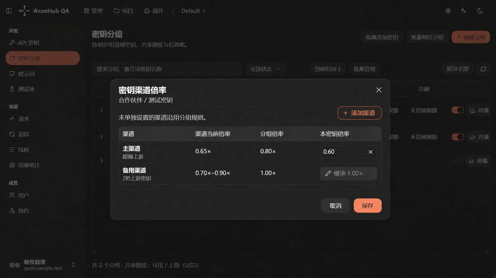
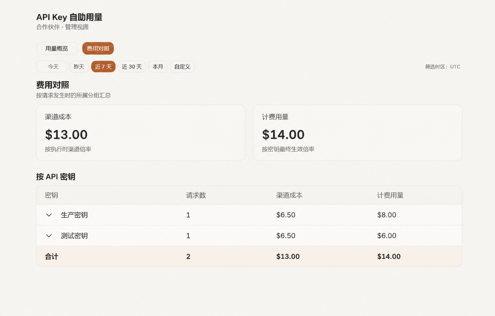

# 密钥渠道倍率与分组费用对照

2026-11-24 · 已按确认方案在本地实现，未部署 · 源码基线 `f52f20ae`

建议给每个渠道保留三层定价。渠道提供默认价，密钥分组可以指定整组的计费倍率，单把 API 密钥可以再为个别渠道指定倍率。管理员能对照渠道成本与对密钥记账的金额，持有密钥的人在「API Key 自助用量」看到后者。两种金额使用相同的请求和用量证据，Token 数和请求数只统计一次。

## 用同组两把密钥走一遍

假设「合作伙伴」的生产密钥和测试密钥各发一次请求，都走主渠道，两次按模型单价、服务档位和用量算出的倍率前金额各为 10 美元。本次实际选中的上游密钥倍率均为 0.65×。管理员为组设置 0.80×，只为测试密钥另设 0.60×。

| 调用方 | 渠道倍率 | 最终计费倍率 | 渠道成本 | 计费用量 |
| --- | --- | --- | ---: | ---: |
| 生产密钥 | 0.65× | 0.80×，继承合作伙伴 | $6.50 | $8.00 |
| 测试密钥 | 0.65× | 0.60×，密钥指定 | $6.50 | $6.00 |
| 分组合计 | | 2 次请求 | **$13.00** | **$14.00** |

两笔金额解释同一批使用记录。分组额度合计消耗 14 美元，两个密钥额度分别消耗 8 和 6 美元。若仅移除测试密钥的例外，下一笔同样请求会回到 8 美元。若再移除分组规则，下一笔继承渠道价，记 6.50 美元。渠道价随后变化时，仅继承渠道价的调用方随之变化。移组后密钥专属规则随密钥保留，继承项随新组，未分组的密钥也可有自己的例外。

## 调价入口和倍率读数

| 要做的事 | 打开位置 | 展示 |
| --- | --- | --- |
| 给整个组设置默认值 | 项目 → 密钥分组 → 目标分组行末「⋯」→「渠道倍率」 | 居中弹窗，标题带分组名，列出渠道当前倍率和本组设置 |
| 只改某把密钥 | 在同一页点分组左侧箭头展开 → 成员密钥行末「⋯」→「渠道倍率」 | 居中弹窗多出「分组倍率」「本密钥倍率」。在「项目 → API 密钥」的密钥行末菜单也能进入同一个弹窗 |
| 看一个组这段时间花了多少 | 分组行右侧现有「用量」→ 新标签页中的「费用对照」 | 同屏两笔金额，可按日期和密钥核对 |
| 持钥人核对消耗 | 现有「API Key 自助用量」 | 汇总、趋势、模型表、请求详情使用最终计费用量 |

现有分组与成员各有独立的行末菜单。分组的「用量」链接已传入项目与分组，以管理员登录身份打开专用视图。[分组按钮](../../frontend/src/features/key-groups/index.tsx) · [成员按钮](../../frontend/src/features/key-groups/member-row.tsx) · [密钥列表菜单](../../frontend/src/features/apikeys/components/data-table-row-actions.tsx) · [分组管理视图](../../frontend/src/features/self-usage/components/managed-group-page.tsx)

**「跟随上游」旁显示数值和来源。** 渠道设置页已有每把上游密钥的当前生效值、来源及观测时间，可复用服务端计算结果。弹窗打开时读现有同步记录。这里的“上游密钥”是网关用来连接供应方的凭据，与用户拿来调用网关的 API 密钥分别显示。[倍率选择与过期处理](../../internal/server/biz/channel_upstream.go) · [渠道管理说明](../zh/guides/channel-management.md#查询上游余额与跟随倍率)

| 状态 | 配置窗口 | 已完成请求的管理明细 |
| --- | --- | --- |
| 各启用上游密钥均为 0.65× | **0.65×** · 跟随上游 | 该次执行取到的 0.65× 和来源 |
| 启用的两把上游密钥分别为 0.70×、0.90× | **0.70×–0.90×** · 2 把，点开查看各自倍率、来源和同步时间 | 展示本次选中的具体值，如 0.90× |
| 采用仍有效的历史值或备用值 | **0.65× · 缓存**或 **1.20× · 备用手动，估算**。范围内含估算项时同时标出数量 | 保存执行时采用的值和来源。成本合计含估算时提示所涉及的记录数 |
| Token 与图片／按次费倍率不同 | 紧凑显示 Token 倍率，展开可看「固定费／图片」的手动倍率；存在差异时行内提示「分项倍率」 | 各费用项各列实际倍率，只有相同时才显示一个总倍率 |
| 无可用渠道凭据，或当前读数未取得 | 明示「无可用凭据」或「暂未取得」，能确定的配置值单独标注 | 历史请求始终读执行时的记录 |

**编辑规则。** 分组弹窗默认展示已指定的渠道，通过「添加渠道」补充。单密钥弹窗自动列出项目范围内、这把密钥各配置允许的已启用渠道。同一渠道只列一行，显示编号、标签和匹配配置。可按配置筛选或搜索名称、标签和编号，连续改价后统一保存。配置范围外已有的密钥倍率可在筛选菜单中查看和恢复继承。输入值是绝对倍率，非负十进制，1.00× 固定按原价，0× 使已定价的项目免费；空白草稿不可保存。「恢复继承」移除本层规则，立即预览下一层结果。整窗保存一次，取消丢弃草稿。选中的渠道仍须满足密钥原有使用权限。

## 管理员如何对账

「费用对照」复用用量页已有的日期筛选和系统时区。上方并列显示「渠道成本」和「计费用量」，下方按 API 密钥列出请求数与两笔金额。展开一把密钥，可按实际渠道看贡献，再看请求明细及倍率来源。组内不固定一个“平均计费倍率”，因为同组的密钥、同一密钥的渠道都可能使用不同价格。

- **渠道成本**取实际执行时每个计费项目适用的渠道倍率。供应方未提供最终账单时，这个金额是 AxonHub 根据已记录价格核算出的渠道用量成本。现有「渠道今日用量」及渠道排行的成本列沿用此口径，另有的「标准成本（1×）」继续作为原价参考。
- **计费用量**对每个项目优先采用「本密钥＋该渠道」设置，其次采用「本组＋该渠道」设置，均未指定时沿用该项目的渠道倍率。只乘一次。分组共享预算和单密钥预算、响应里的 `usage.cost`、API 密钥用量统计和自助用量的成本明细都使用该结果。单项缺价时沿用原有未定价语义，0× 也不能补出缺失的基础价格。
- **归属与可见性。** 管理费用对照按请求发生时的计费分组归属，所以 11 月归甲组、12 月调到乙组的密钥，11 月费用仍能在甲组对上。原有按当前成员查询的「用量概览」保留原范围，在两处标明归属口径。持钥人切换自己的密钥／分组范围，前后端只提供计费用量和对应分项。开启「自助显示渠道名称」后，渠道名称旁的「本次计费倍率」、悬浮提示及费用明细均采用请求发生时对该密钥实际生效的计费倍率。文首两笔请求分别显示「主渠道 ×0.80」和「主渠道 ×0.60」。若整笔继承渠道，显示的数值可以与渠道倍率相同。若各已计费项目倍率不同，显示「混合倍率」，明细按项目列出；缺少倍率依据时显示「—」。渠道列及其接口只提供持钥人计费口径，原始渠道成本、单独的上游倍率和费用对照限获授权的管理员查看。[现有用量与移组语义](../zh/guides/self-usage.md)
- **可核对的合计。** 对照页两列使用同一时间范围、项目、组以及实际用量账目。每次执行按现有入账规则记录两种金额，失败重试有真实用量时保留，重复结算不会增加金额。请求数按请求 ID 去重，多渠道子行的请求数不可直接相加。任一侧缺少价格依据时显示已知合计和缺价笔数；没有已知金额显示「—」，0 单独显示。[消费统计口径](../zh/development/consumption-statistics.md)

## 数据和实现边界

1. **存储规则。** 建立分组－渠道和 API 密钥－渠道两种关联，各自用对象 ID 和渠道 ID 联合唯一，服务端通过对象验证项目。只存例外。按同一规则读取、校验、事务保存和恢复继承；用版本校验避免旧草稿覆盖新价格。写入需具备目标项目的密钥管理权限及渠道定价写权限，读取费用对照须具备该项目的用量读取及相应渠道成本读取权。自助接口不向浏览器下发渠道成本，管理员统计查询和缓存按项目、授权身份与日期范围隔离。
2. **派发前冻结依据。** 用实际渠道、模型、上游密钥及调用方密钥建立执行记录，保存计费组 ID、两边费用项目的实际倍率、来源和价格版本。沿用已有预算归属规则，首次派发时确定组，重试保留同一组并按新渠道报价。即使未启用预算也保存计费组。与移组并发时，计价归属和预算归属必须一致。已派发的流式、异步、重试前的执行均保留各自快照。按“同价”择优切换的候选也需核对本次有效计费条件，保留原渠道成本等价要求。[执行取价](../../internal/server/biz/request_cost_snapshot.go) · [预算归属](../../internal/server/biz/budget_admission.go) · [同价候选](../../internal/server/orchestrator/first_content_selection.go)
3. **一次算用量，分别记金额。** 阶梯、缓存、加速模式、固定费和图片档位先确定各项倍率前小计，再分别计算渠道成本与计费金额。预算预留根据预计用量乘计费倍率，结算根据真实用量乘同一执行保存的计费倍率。保留用量日志 `total_cost` 既有渠道成本含义，新增明确的计费金额及其分项依据。客户端响应、自助接口和扣额显式读取计费金额；渠道比较取渠道成本；标准成本继续取倍率前口径。归档、备份恢复、统计汇总与缓存一起支持两种金额，避免实时与归档账目重复累加。[用量表](../../internal/ent/schema/usage_log.go) · [费用计算](../../internal/server/biz/service_tier_cost.go) · [归档表](../../internal/ent/schema/usage_archive.go)
4. **升级和历史。** 规则初始为空，两种金额在上线前已有完整计价的记录上相等，可沿用原值。用记录的计费版本区分“旧账共用金额”和“新账第二金额缺失”，保留 0 和未知的差别。历史计费分组可由当时的执行或预算记录确证时才归入该组；无法证明的旧账单独注明可追溯范围，不用当前组员关系冒充历史归属。恢复备份时按对象映射还原规则，历史快照保留原值。需按仓库迁移约定核对升级与跨方言行为。

## 实施验收

- 以文首两把密钥为共同样本，管理员看到 13 / 14，持钥人分别看到 8 / 6，预算和响应使用同一计费结果。管理员改组倍率后只影响继承该值的新执行。
- 覆盖手动、上游单值、多值、缓存和备用手动；混合 Token 与图片时按分项核对，并核对配置窗口当前值与执行时历史值的区别。
- 测试 0×、1×、缺价、恢复继承、未分组密钥、移组、同名分组跨项目，以及普通密钥管理者无法自行设置免费、持钥人无法读取渠道成本。
- 重试换渠道、晚到结算、流式改价后，逐笔金额与合计一致；归档／恢复前后两列相同，旧账的未知金额或归属有明确标记。
