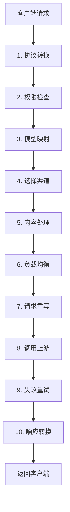

# 请求处理流程指南

本文介绍一个请求进入 AxonHub 后，大致会经过哪些步骤。它的目标是帮助你建立一个简单、准确的心智模型。

## 一句话总结

AxonHub 会先把请求转换成统一格式，再根据配置选择渠道，最后把结果转换回客户端期望的格式。

## 核心概念：三层模型设置

AxonHub 中有三个地方会影响模型名称：

| 层级 | 配置位置 | 作用 | 简单理解 |
|------|---------|------|---------|
| 第 1 层 | API Key Profile | 改写客户端请求的模型名 | 改"想要什么" |
| 第 2 层 | 模型关联 | 选择处理请求的渠道 | 选"去哪处理" |
| 第 3 层 | 渠道配置 | 改写发给上游的模型名 | 改"怎么称呼" |

**处理顺序**：API Key Profile 改模型名 → 模型关联选渠道 → 渠道改模型名 → 发给上游

## 完整处理流程



## 各阶段说明

### 1. 协议转换

AxonHub 支持多种 API 格式（如 OpenAI、Anthropic、Gemini），会先把请求转换成统一的内部格式。

### 2. 权限检查

系统会先检查 API Key 和当前 Profile 的基本限制，例如：
- API Key 是否有效
- 是否超出额度
- 是否允许访问该模型

如果失败，请求会在这里直接返回错误。

### 3. 模型映射

这是第一层模型名称改写，由 API Key Profile 的模型映射决定。

例如：

```
客户端请求: gpt-4
    ↓
API Key Profile: gpt-4 → claude-3-opus
```

### 4. 选择渠道

系统会根据模型关联，找出哪些渠道可以处理当前请求。

这一步通常会结合：
- 模型自身关联规则
- 同开发者的开发者规则，除非模型开启了“不继承开发者配置”
- API Key Profile 的渠道限制
- 渠道是否启用

开发者规则只选择渠道或渠道标签；具体匹配哪个上游模型由当前请求的模型 ID 决定，因此同一条开发者规则可以同时服务同开发者下的多个模型。

### 5. 内容处理

在发送给上游之前，系统还可能做一些内容处理，例如：
- 提示词注入
- 提示词保护

### 6. 负载均衡

如果有多个候选渠道，系统会决定先尝试哪个渠道。

常见影响因素包括：
- 渠道权重
- 历史状态
- 当前负载

### 7. 请求重写

在渠道层，系统可以进一步改写要发送给上游的模型名和请求参数。

### 8. 调用上游

系统把请求发送给选定的 AI 服务商。

AxonHub 自建的原生 HTTP 客户端按实际目标上游隔离连接池，并继续复用正常连接。如果已经获得连接，但请求上传在期限内未完成，后续请求会改用该上游的新连接池；旧池停止接收新请求，正在返回的其他响应继续完成后再回收。用户取消、连接建立失败、参数错误，以及上传完成后的响应等待超时不会触发此恢复。

每个实际目标从一组连接池开始，后端自动识别并发上传压力，不需要按渠道或生产机配置。检测到同一 HTTP/2 连接上至少两条尚未完成的上传，其中已知正文不小于 64 KiB 的请求上传超过 2 秒，且按完整正文除以已过时间估算的速度不高于 256 KiB/s 时，后续真实请求可试用新增的一组连接。完成上传时观察到的同类证据保留一分钟，仅在下一批当前已有可识别且已取得连接的 HTTP/2 上传时复用；建连、已传完正文后的模型等待、早到的响应头和用户取消不作为慢上传依据。正常请求优先使用正在上传较少的现有组，同等情况下兼顾在途响应数量并轮换选择。

每次只增加一组，最多八组，并至少间隔十秒。新增组须在一分钟内完成两次正文不小于慢样本的 HTTP/2 上传、获得非错误响应头，且每字节上传耗时都至少低 25%，才允许继续扩容。没有可比证据、没有改善或收到错误响应时暂停扩容一分钟；若还有其他接收新请求的组，新增组停止接收新请求，已有响应完成后回收；判定时已经空闲的组立即回收，即使空闲超时设置为 0。各组空闲后独立按原有空闲期限回收。这些判断是有界的传输优化尝试，不是线路故障定因或提速保证；不会主动发送探测请求，也不会迁移已发送请求。显式限制每目标连接总数或禁用连接复用的客户端不自动扩容。

每组最多保留一个使用中的版本和一个等待请求结束的旧版本；旧版本在最后一个响应结束后关闭自有连接，实际关闭完成前不允许为该组恢复出第三个版本。恢复后的版本需要完成一次正文不小于失败请求的上传并收到响应头，才允许再次恢复，两项证据可以任意顺序到达；小请求成功不会证明大请求已经恢复。外部注入的自定义 HTTP 客户端、自定义 TLS 拨号器、SDK 自管连接和原生 WebSocket 不自动接管这一机制。状态仅在当前进程内按 HTTP 客户端和目标地址隔离，不涉及持久缓存或数据库迁移，也不会修改渠道、模型或供应商选择。

“上游请求分段计时”日志包含连接池版本、连接标识、是否复用和实际 HTTP 协议。恢复触发、扩容动作、同等大小上传验证及已完成但上传达到两秒的请求会记录在 info 级别；`pool_replaced` 表示后续请求已经切换到新版本，`upload_verified` 只证明同等或更大的上传完成，不代表整个模型请求成功。`pool_count` 是本次分配时的池组数（可包含正在收尾的组，不等于 TCP 连接数），`pool_action` 的 `expanded`、`expansion_verified`、`expansion_unhelpful`／`expansion_unverified` 分别表示试增容量、获得改善证据、未获改善或充分证据；`baseline_reopened` 表示旧试验组仍在收尾时重建基础容量。记录不包含正文或凭据。

### 9. 失败重试

如果调用失败，系统可能会重试，或者切换到下一个候选渠道。

连接池扩缩容、恢复与请求重试独立：增加或更换池本身不会重发原请求，也不会增加原有重试次数或调整超时设置。已发送但执行结果未知的请求继续遵守原有禁止重放规则。

### 10. 响应转换

系统把上游返回的结果转换回客户端期望的格式，并记录请求结果。

流式请求的上游执行结果与客户端交付结果分别记录。例如，上游已生成完整响应，但网关发送最终完成事件时客户端连接取消，上游执行仍为“已完成”，整个请求为“已取消”，错误详情会记录“向客户端交付响应”阶段及取消原因。写入失败或超时则记为“失败”；没有交付确认且没有明确取消原因时，也不会推定成功或取消。已成功发送最终完成事件后再断开，不会撤销完成状态。

HTTP 200 只表示流式响应已开始，不能证明客户端收到完整结果。交付中断不会删除已经取得的上游用量，也不会自动重新发送生成请求。新增交付诊断不会回填旧请求；对于缺少详细证据的历史记录，不能只凭“上游完成”改判整个请求成功。

## 什么时候看哪篇文档

| 如果你的问题是 | 优先看 |
|--------------|---------|
| 想改客户端请求的模型名 | API Key Profile |
| 想决定请求走哪个渠道 | 模型关联 |
| 想改发给上游的模型名或请求参数 | 渠道配置 |

## 相关文档

- [渠道管理指南](../guides/channel-management.md)
- [模型管理指南](../guides/model-management.md)
- [API Key Profile 指南](../guides/api-key-profiles.md)
- [负载均衡指南](../guides/load-balance.md)
