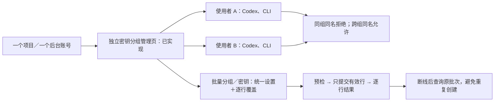
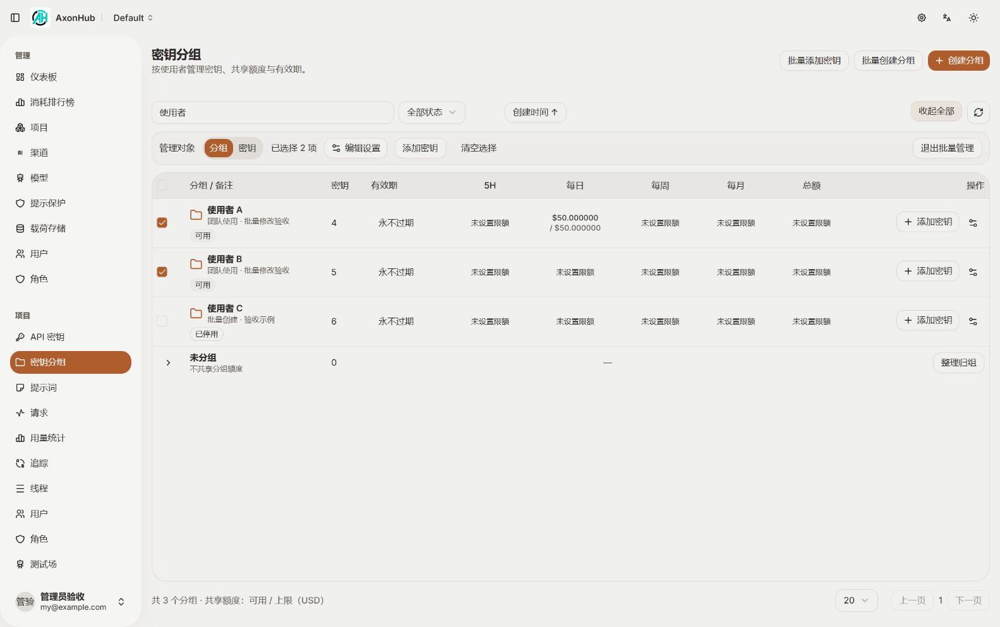
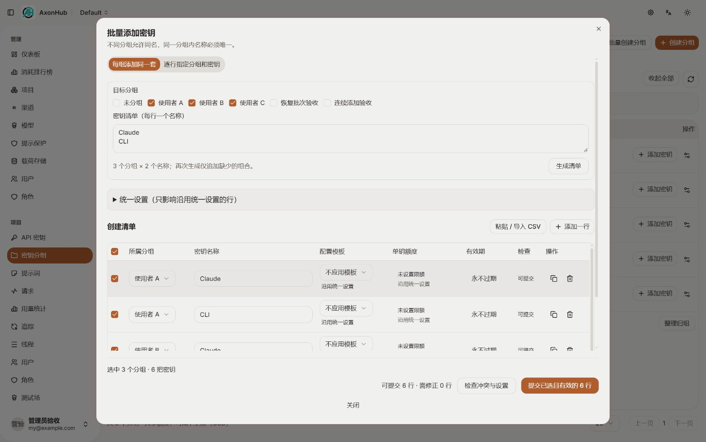

# 密钥分组管理实施与验收

日期：2026-10-30。状态：用户确认范围已实现并完成本地隔离联调；经用户指定的 gpt-6.1-sol / max 独立复审和主执行者自检，发现的问题已修复并复验，未发现剩余阻断项。验收基线为 `be9b673f`；用户现已明确授权将本需求提交到 Git，尚未推送或发布。真实多数据库与全量类型检查的限制仍见文末，不将本地验收等同于全环境验证。

管理员现在可以在一个项目、一个后台账号下，以分组代表使用者，给每个使用者分发多把密钥。入口是“项目 → 密钥分组”，原有“API 密钥”列表仍可使用。设计来源和六张已确认预览见[设计记录](../../design/axon-group-management-20261030/README.md)。

## 可视化汇报



下列均为真实页面截图，数据来自本轮隔离验收库，密钥原文没有显示。

| 实际页面 | 可核对的行为 |
| --- | --- |
| [分组管理主页面](group-management.jpg) | 分组数量、共享额度、启停、备注及分组／密钥批量模式 |
| [展开组内密钥](group-members.jpg) | 屏蔽密钥原文，显示独立额度与配置入口，移入已有密钥 |
| [批量添加密钥](batch-keys.jpg) | 多个分组添加同一套名称，模板／单钥额度／有效期独立列与提交预检 |
| [批量创建结果](batch-results.jpg) | 六行成功回执，主动选择复制／导出入口，默认遮盖原文 |
| [批量编辑](batch-edit.jpg) | 只修改勾选字段；两组备注更新不重置共享额度 |
| [小屏主页面](mobile.jpg) / [小屏长表单](mobile-create.jpg) | 局部横向滚动，长表单关闭和提交操作可达 |





## 完成范围与行为

| 需求 | 实现结果与依据 |
| --- | --- |
| 独立分组页面 | 服务端搜索分组、备注、密钥名，状态筛选和分页；成员展开后单独分页；未分组是特殊视图，不生成一个真实分组 |
| 分组启停与备注 | 分组停用后拒绝组内密钥认证，即使凭据缓存已命中；恢复分组不覆盖成员自身的禁用状态 |
| 同名规则 | 项目＋所属分组内唯一，未分组单独唯一；不同组可同名；停用／归档仍占名；改名与移组按最终目标组合核对 |
| 删除分组 | 成员移为未分组；目标名称冲突时拒绝该行，其他分组成功行不回滚；不删除成员密钥 |
| 创建分组和初始密钥 | 单条、批量共用业务接口；可组合初始密钥清单、模板、IP、共享和独立额度；每行整体成功或整体回滚 |
| 灵活批量添加 | 多组×名称集合，或逐行指定分组；支持粘贴／CSV／TSV列映射、添加／复制／删除行、逐行覆盖和恢复统一设置；再次生成只补缺少组合 |
| 批量管理 | 分组与密钥分开选；仅勾选字段被提交；清空备注、IP、限额和有效期均为明确操作；预算只修改选定周期，不清零已用和暂占 |
| 结果恢复 | 每行回执与对象在同一事务写入；同一批次／行重试返回既有结果，改动载荷复用旧编号会被拒绝；浏览器刷新后可以恢复未确认结果的原请求 |
| 权限与项目隔离 | 沿用项目管理权限、个人密钥创建者限制、模板所属项目与类型权限；服务账号须显式选择权限；新入口不生成后台登录账号 |
| 额度汇总 | 分组预算批量查询和汇总，避免逐组重复读取；保留请求发生时归属的预算账本；用量报表仍按当前成员汇总，两者未混用 |
| OpenAPI 同名定位 | 按名称查询可指定分组；不指定且有多个匹配时返回歧义错误，不任意选一个 |

每批最多 100 行，每行最多 100 把初始密钥。成功回执不保存密钥原文；页面仅在用户主动显示、复制或导出时调用原有授权读取入口。浏览器恢复信息按当前账号和项目隔离，保存在当前标签会话中；关闭该会话后不提供跨设备草稿恢复。

## 本地联调记录

使用独立 SQLite 合成数据及仅绑定 `127.0.0.1` 的临时后端 `18099`、前端 `15179`，没有修改用户原有服务数据库，没有向真实模型供应商发起请求。

1. 创建“使用者 A”及首把 Codex，设置共享每日 50；成功后列表回读 1 把密钥和 50 额度。
2. 粘贴“使用者 B”“使用者 C”和重复“使用者 A”；预检 2 行有效、1 行冲突，只提交两行，冲突行保留修改入口。
3. 三组各添加“手机”“备用”，C 的“备用”单独设置每日 10；再次生成组合不覆盖该行设置，六行成功，成员额度回读一致。
4. 停用 C 后列表显示停用，成员自身启用状态保留；认证缓存与停用拦截另外由业务测试验证。
5. A/Codex 移到 C 因同名被拒绝；同一表单同时改名为“Codex（移组验收）”后成功，源组与目标组数量刷新。
6. 临时停止本轮隔离后端，提交“恢复批次验收”触发结果未知；恢复服务并刷新浏览器后，按原批次恢复，最终只创建一个分组。
7. 单条创建“连续添加验收”后点继续添加，分组和配置保留、名称清空；取消后正常返回。
8. 分组／密钥批量模式切换清空不适用的选择。只勾选 A/B 备注批量更新，A 原共享每日 50 未改变，C 未被修改。
9. 最终后端版本重新启动后，三组各添加 Claude／CLI，C/CLI 单独每日 10；预检六行有效，真实提交六行全部成功，A/B/C 数量回读为 4/5/6。
10. 1584×993、1280×720 和 390×844 视口检查；列表局部滚动，长窗口操作区可达，取消／重开正常；批量清单滚动时固定表头，逐行覆盖不会增加额外一行高度。最终浏览器错误／警告日志为空。

## 自动验证及命令

在仓库根执行：

```powershell
go test ./internal/server/biz ./internal/server/gql ./internal/server/gql/openapi ./internal/server/db -run 'TestAPIKey|TestKeyManagement|TestManagedGroup|TestBudget|TestOpenAPIResolver|TestKeyGroupManagementSchemaUpgrade' -count=1
go test ./internal/server/biz -run TestManagedGroupPaginationAndAvailability -count=1
$env:AXONHUB_TEST_SQLITE_DSN='file:C:/Users/xiaowei/.codex/verification-scratch/axon-group-management-20261030/final-race.db?_fk=1&_pragma=journal_mode(WAL)'
go test -tags=dbrace ./internal/server/biz/racetest -run 'TestAPIKeyNameRace|TestAPIKeyGroupNameRace' -count=1
git diff --check
```

结果全部通过。并发检查仅配置独立 SQLite DSN，未使用其他数据库连接。上面的临时目录已清理，复现并发命令前应按 verification-cleanup 重新准备独立目录和数据库路径。测试覆盖每行完整回滚、回执重复恢复和账号隔离、模板激活与 IP 保存、跨项目／无权限拒绝、分组停用与认证缓存、名称冲突、版本冲突、额度已用保留、分页与耗尽状态，以及旧分组表升级后默认启用、重复升级和回执唯一约束。

在 `frontend` 执行：

```powershell
$env:pnpm_config_verify_deps_before_run='false'
node --test src/features/key-groups/drafts.test.mjs
pnpm exec tsc --noEmit -p tsconfig.app.json
```

初轮三项数据处理测试通过；独立复审阶段补充浏览器存储不可写时的恢复测试，共四项通过。覆盖 Excel／CSV 引号、逗号、换行、统一值与覆盖值、跨组同名的稳定行编号及账号／项目隔离的内存恢复。`tsc` 返回 2，共 172 项诊断，均在未改动区域；`key-groups` 及本轮修改的导航、路由权限、旧分组入口与直接关联的数据模块没有类型诊断。没有运行 lint 或 build。上述 pnpm 变量仅作用于命令进程，用于复用项目已有依赖，未安装或修改全局配置。

本轮 Go 文件使用 `gofmt`、前端相关文件使用 Prettier 格式化。手写新文件均未超过 2200 行；生成代码沿用项目生成器。

## 代码与文档位置

以下 `new` 表示本轮新增，生成文件不逐一展开：

- [前端页面与操作流程](../../../frontend/src/features/key-groups/index.tsx)（new），同目录的创建、批量修改、成员、移组、提交恢复与数据模块；[路由](../../../frontend/src/routes/_authenticated/project/key-groups/index.tsx)（new）、中英文 `key-groups.json`（new）。
- [管理业务入口](../../../internal/server/biz/api_key_management.go)（new）、查询／校验／DTO、批量预算摘要（new）；[名称规则](../../../internal/server/biz/api_key_names.go)（new）；原有密钥、分组、认证和预算服务同步接入。
- [GraphQL 管理接口](../../../internal/server/gql/key_management.graphql)（new）、对应 resolver（new）及生成代码；OpenAPI 参数与直接调用方同步。
- [回执 schema](../../../internal/ent/schema/api_key_operation.go)（new）、分组字段及 Ent 生成代码。未新增 data migration 版本、未改已发布迁移；已对照直接上游 `v1.0.0-beta10-fork.7`／`b205ae8e`。
- [业务回归](../../../internal/server/biz/api_key_management_test.go)（new）、[旧表升级测试](../../../internal/server/db/key_group_upgrade_test.go)（new）、现有分组／OpenAPI／并发测试、[前端数据测试](../../../frontend/src/features/key-groups/drafts.test.mjs)（new）。
- [中文使用说明](../../../docs/zh/guides/self-usage.md)、[英文使用说明](../../../docs/en/guides/self-usage.md)、[Fork 台账](../../../docs/fork-maintenance.md)已同步。

## 错误解释与验证边界

- 原工作目录执行 GraphQL 生成时，Windows 拒绝写入被映射打开的生成文件；具体占用进程没有查明。相同源码和相同 `go -C internal/server/gql generate` 在受管隔离目录成功，随后回装生成文件并完成编译测试。没有换生成器，也没有手写生成代码。这个文件占用问题不等于业务实现失败，更不是停止整个需求的依据。
- 全量 TypeScript 尚未通过，172 项存量诊断没有扩展到本轮范围外修复。
- SQLite 已验证，MySQL／PostgreSQL／TiDB 的真实实例迁移和并发未验证；跨方言查询与项目锁保留既有约定，不把 SQLite 结果当成其他数据库的实测结论。
- 未发起真实供应商请求，未做压力测试；认证、预算预占和结算由本地测试覆盖。
- 密钥原文显示、系统剪贴板和含凭据 CSV 下载没有实际执行；默认遮盖、成功结果选择与导出入口已检查，CSV 数据处理已自动测试。
- 临时前端 `15179`、后端 `18099` 和本轮子进程已关闭，浏览器视口已恢复、验收标签已关闭。用户原有 `5173`／`8090` 服务仍在运行。受管清理返回 `cleaned=true`、`task_root_removed=true`，删除本轮 1786 个临时项，预先存在的 scratch 根目录保留。

本文件和本目录截图均为 new。其他任务已有文件未清理，也未进行 Git 暂存、提交或推送。

## 独立复审与自检（2026-10-30）

用户指定的独立审查者使用 `gpt-6.1-sol`、`max`，只读核对计划、项目规则、源码与测试，不参与修复。主执行者同步自检并实施修正，随后由同一审查者再次核验。初轮发现不能被测试通过掩盖；下表均已闭环。

| 来源与问题 | 修正及验收 |
| --- | --- |
| 独立审查：MySQL 普通读取可能保留等待项目锁前的快照，并发移组漏判重名或目标组已删除 | 在项目锁后对密钥、最终名称冲突和目标组存在性使用当前读，保持项目→密钥→预算的锁顺序，不改全局事务隔离。新增 `TestAPIKeyGroupMoveRace`，SQLite 50 路并发移组通过；MySQL 原理依据见[官方一致性读说明](https://dev.mysql.com/doc/refman/8.4/en/innodb-consistent-read.html)，没有声称实例复现或实测通过 |
| 自检发现、独立确认：备份只存组名，恢复会丢备注、空组并重新启用停用组 | 备份格式 1.6 保存分组对象、备注和启停；接受 1.5 及更早格式；按原冲突策略跳过／覆盖／报错。新增停用组、空组、旧格式及冲突策略测试；独立复跑还发现孤立历史组缺父项目的读取问题，已沿用既有历史备份语义修正，备份包全量测试通过 |
| 独立审查：未知批次窗口锁住整页 | 创建／编辑窗口允许在结果未知时关闭，恢复窗口可收起并保留入口。原请求未核对前不允许另一请求覆盖它；刷新查询失败不改变已确认的提交结果。浏览器实测离线提交→关闭→收起→恢复服务→恢复原批次，只生成一条 CLI |
| 独立复核：存储不可写时关闭窗口可能丢失原请求 | 按账号＋项目保留页面生命周期内存副本，清除时保留空状态，避免重新读取旧存储。四项前端测试中包含存储完全拒绝读写和跨账号／项目隔离用例 |
| 独立审查：多列导入空白组名静默归为未分组 | 空白明确报错，仅显式“未分组”才映射为 0；组内单列仍继承目标组。真实浏览器检查空白被拒绝、明确未分组可追加 |
| 主执行者自检：额度版本与关联页面缓存未同步 | 额度版本查询按当前账号隔离，归入既有预算缓存并在重开时重取；新旧密钥／分组／预算操作刷新直接相关新视图，新入口同步已有请求详情和统计缓存。不刷新页面连续把同一密钥每日额度设为 20、30，均成功，列表回读 30；复用配置弹窗保存后成员立即显示“配置回读验收” |
| 独立复核：移组候选遗漏账号维度 | 新增查询键加入当前账号，并要求账号和项目都已就绪，避免切换账号复用前一账号的个人密钥候选；未修改全局登录登出机制 |
| 独立审查非阻断项：预算操作编号遗漏账号 | 派生编号纳入项目、账号、批次、行；两账号复用同一批次／行编号且各设置预算的回归通过 |

补充 `TestKeyManagementAuthorizationWithoutBypass`：使用不含测试绕过权限的普通用户上下文，五个新增管理服务入口均拒绝访问，未生成分组。不是通过前端隐藏按钮来充当权限校验。

复审命令包括：

```powershell
go test ./internal/server/backup -count=1
go test ./internal/server/biz -run 'TestAPIKey|TestKeyManagement|TestManagedGroup|TestBudget' -count=1
go test -tags=dbrace ./internal/server/biz/racetest -run 'TestAPIKeyGroupMoveRace|TestAPIKeyGroupNameRace|TestAPIKeyNameRace' -count=1
node --test src/features/key-groups/drafts.test.mjs
pnpm exec tsc --noEmit -p tsconfig.app.json
git diff --check
```

前端命令在 `frontend` 下执行。并发命令使用本轮独立 SQLite `move-race.db`，未配置其他数据库。独立审查者另行复跑相关业务、GraphQL、OpenAPI、数据库检查、备份全包和四项前端测试，最终结论为“未发现剩余阻断，修复属于既定需求直接影响，未偏离主线”。主执行者的浏览器复验使用新隔离库；恢复结束后刷新页面，错误／警告日志为空。

复验实际截图（new）：[连续额度修改回读](review-repeat-budget.jpg)、[配置即时回读](review-profile-refresh.jpg)、[空白分组明确拒绝](review-empty-group.jpg)、[恢复窗口收起后的入口](review-recovery-deferred.jpg)、[原批次恢复结果](review-recovery-result.jpg)。这些截图补充初轮证据，不替换原已确认设计。

涉及的直接关联文件包括原有 [备份／恢复分组](../../../internal/server/backup/api_key_group.go)、[备份类型与版本](../../../internal/server/backup/types.go)、[密钥变更缓存](../../../frontend/src/features/apikeys/data/apikeys.ts)、[预算变更缓存](../../../frontend/src/features/budgets/data.ts)，以及本功能的提交恢复、导入、移组和版本查询。没有扩展到存量类型错误、其他功能重构、全局权限或事务机制。

最终布局复验把恢复入口放在列表上方，避免覆盖窄屏分页；再次离线提交、收起及恢复也成功。本次复审的 `15179`／`18099` 服务与子进程、验收标签均已关闭，受管清理返回 `cleaned=true`、`task_root_removed=true`，移除 1780 个本轮临时项，原有 scratch 根目录和用户服务保留。最终五个 Go 包相关回归均通过，工作区差异检查通过，未暂存或提交。

## 限定范围再次复审（2026-10-30）

按用户要求，主执行者与同一位 `gpt-6.1-sol / max` 独立审查者仅核对上轮出现问题的修复点及直接影响：锁后查重与目标组验证、分组备份恢复、未知批次保存／关闭、导入归属、额度与移组候选缓存、预算操作账号隔离。没有重审未受影响的页面主体、其他 CRUD、预算账本、OpenAPI 或生成代码，也没有重跑全套已通过测试。

本轮发现并局部修复两处原问题遗漏：

- **导入归属边界**：多列清单中的少列行仍可能被当成单列，绕过组列校验；整份单列清单未选目标时也会默认未分组。现在 [实际导入函数](../../../frontend/src/features/key-groups/drafts.ts)按整份清单列数和映射判定；单列仅继承一个明确目标，0 也须明确选择，无目标／多目标拒绝。创建弹窗直接调用该函数，名称列同样不再逐行回退。
- **旧入口缓存覆盖**：旧密钥变更和分组删除现在同步失效 `managementMoveCandidates`，避免立即重开移组窗口时复用旧候选或旧版本号。没有给只改组名或预算操作增加无关候选刷新。

主执行者与独立审查者分别只执行新增导入用例：在 `frontend` 运行 `node --test --test-name-pattern=导入归属 src/features/key-groups/drafts.test.mjs`，1 个用例、9 条断言通过，覆盖缺列、空白、未知组、显式未分组，以及单列 0／1／多目标。此前四项测试证据复用，不将其报告为本轮重跑。本次没有启动服务、访问数据库或创建验证临时目录；界面布局和提交接口未改变，验证集中于实际使用的导入映射函数、调用方和缓存失效差异。

独立复核结论：两处遗漏已闭环，限定范围内未发现新增问题或直接回归。前述真实多数据库、凭据导出及全量类型检查限制保持不变，未扩大范围处理。仍未暂存、提交或推送。

本次修改文件定向 TypeScript 检查为 0 项诊断，相关文件 Prettier 格式化及 `git diff --check` 通过；不替代前述全量类型检查限制。

### 修复后再复审：本轮零新增问题

用户要求每次修复后继续限定复审，因此由同一位 `gpt-6.1-sol / max` 独立审查者再次核对刚修正的两处，主执行者同步自检。本轮仅检查 `importedGroup` 与 `addImported` 的实际调用、整表列映射和 9 条断言，以及旧入口新增失效键与移组候选查询键的对应关系；未重新审查其他已通过范围。

结论：**本轮限定复审未发现新增问题、遗漏或直接回归，两处修复已闭环。** 未发生新的业务代码修复，因此本次修复—复审循环到此完成。复用上一轮定向测试与类型检查证据，没有重复跑测试、启动服务或访问数据库；只追加本段复审记录，未暂存、提交或推送。原有环境验证边界保持不变。

## Git 提交授权

2026-10-30，用户明确要求“提交git”。本次提交包含该需求的实现、测试、文档、六张最终预览和实际验收截图，不包含其他任务产物与已替代设计草稿。前文“未提交”描述各轮验收结束时的历史状态；当前提交按此次明确授权执行，不推送或发布。
