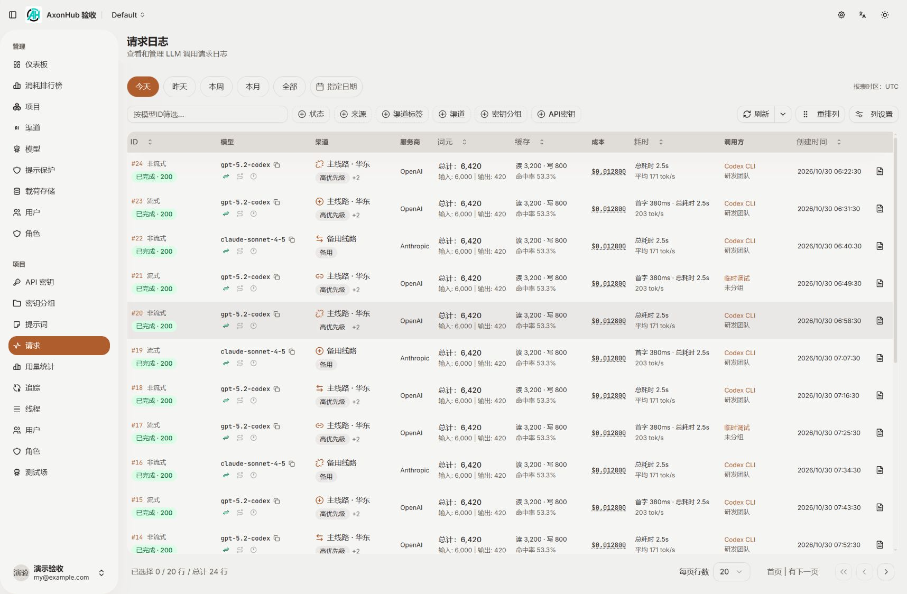
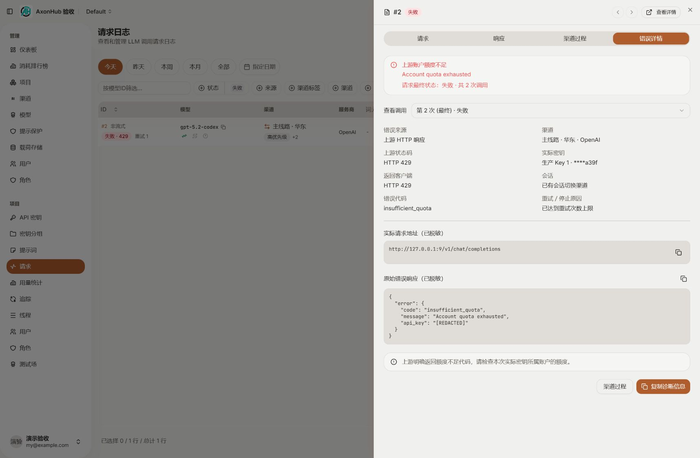
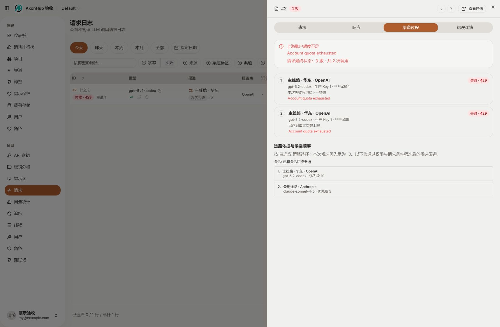
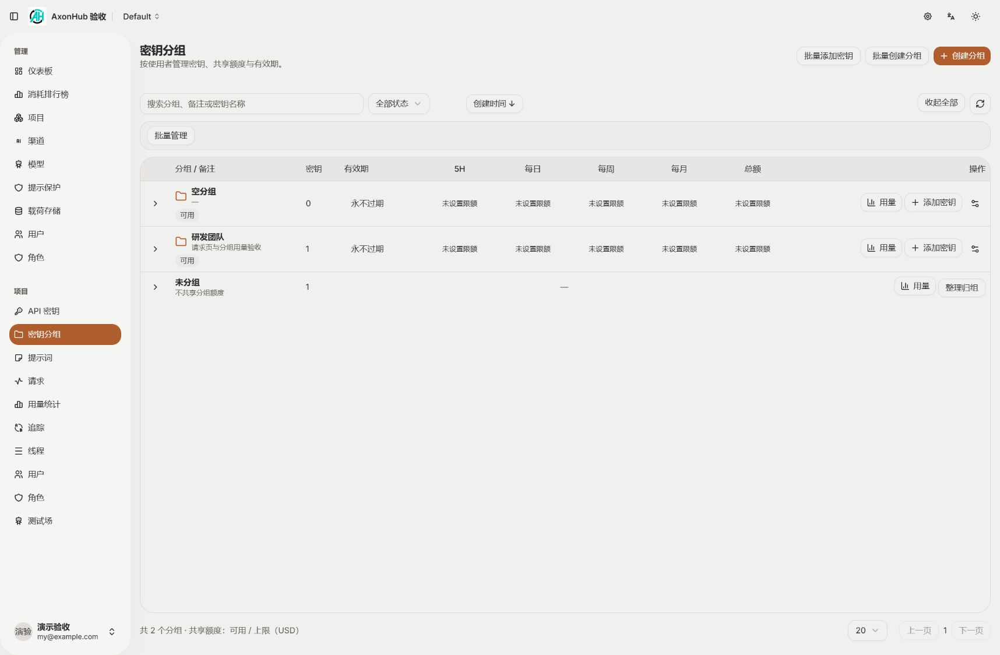
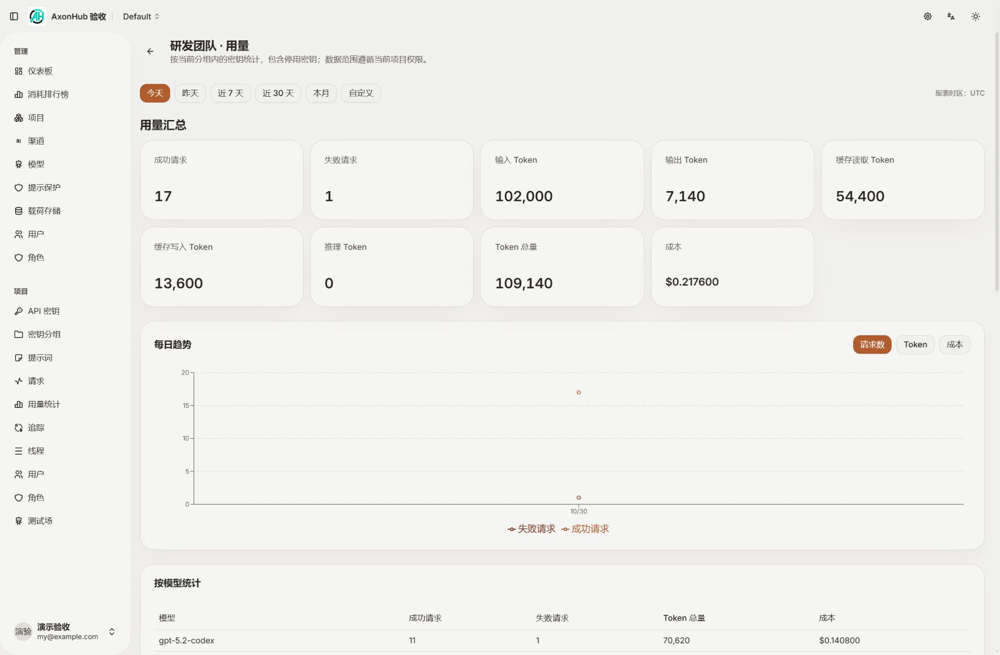
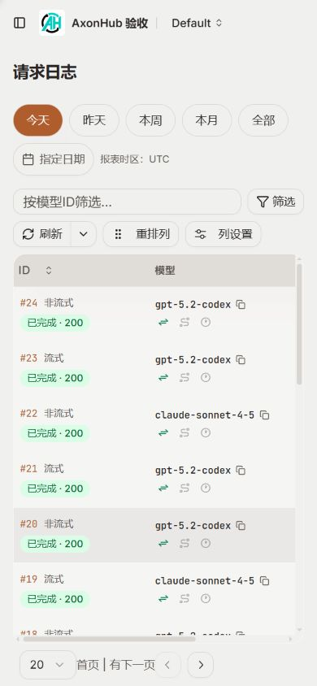
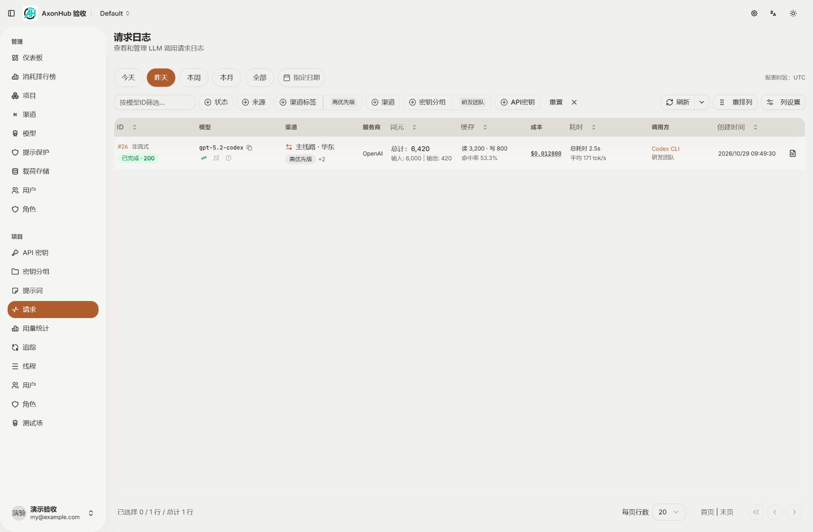
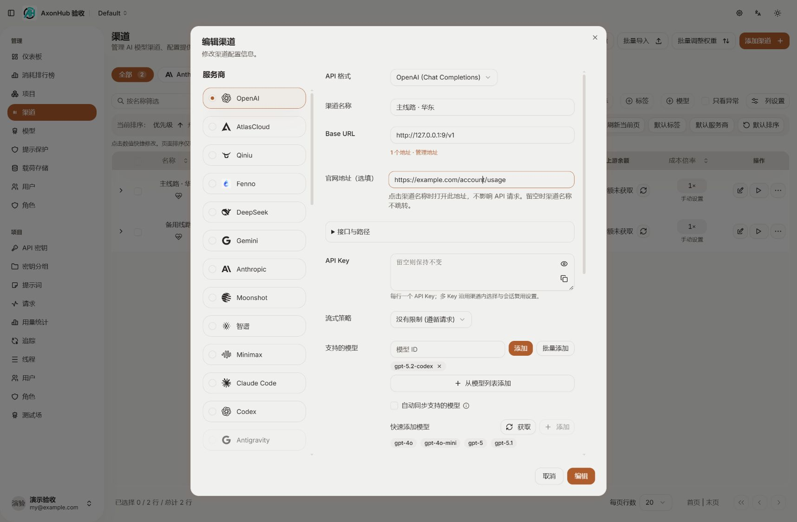
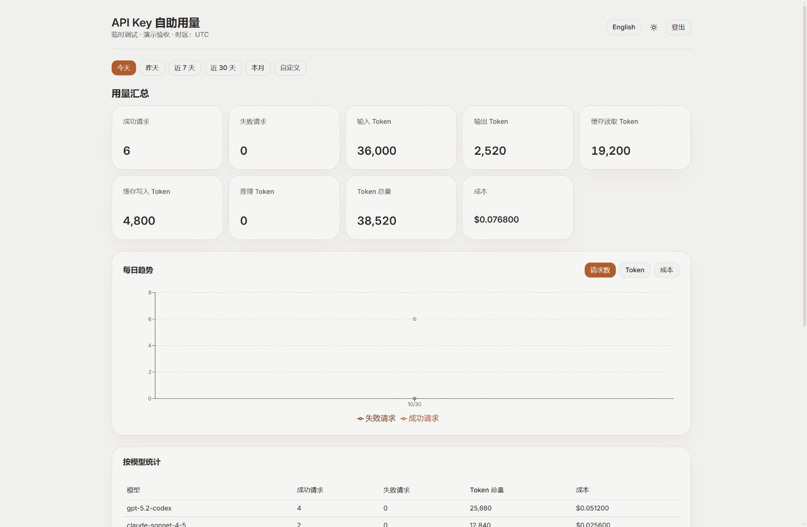
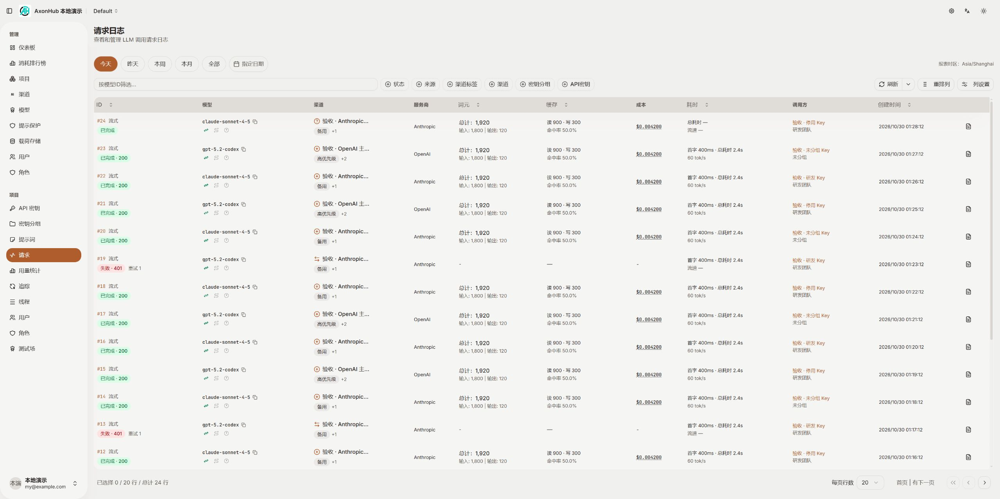

# 请求筛选、逐次诊断与用量入口验收

2026-10-30：实现、自检、独立限定复审及用户人工验收完成；本地前后端已关闭，未推送、未发布。以下截图为本阶段实际运行记录，使用隔离 SQLite 示例数据，不是设计效果图。

## 交付行为

| 场景 | 当前行为 |
| --- | --- |
| 请求时间范围 | 默认今天；今天、昨天、本周、本月、全部、含秒的指定时间；按系统报表时区计算 |
| 组合筛选 | 增加渠道标签、密钥分组与未分组；同项 OR、不同项 AND；条件保存在 URL，变更条件重置分页 |
| 请求表格 | 状态含 HTTP 码和重试次数；渠道两行展示及标签缩略；服务商独立列；模型 ID 复制；缓存读写分列值与命中率；首字、总耗时和输出速度 |
| 调用方 | 点击 Key 或分组名称直接筛选；使用现有权限读取选项 |
| 渠道过程与错误详情 | 展示逐次实际渠道、Key 备注和末四位、会话状态、候选顺序、错误来源、上游／客户端状态、脱敏响应与实际重试／停止动作 |
| 官网 | 与 API 地址独立、可选；HTTP(S) 且不含账号密码；未填时渠道名称不跳外链；渠道名称仍保持全局唯一 |
| 分组用量 | 分组行新增用量按钮；管理账号按当前项目直接查看历史，空组和停用 Key 无需借用有效 Key 登录 |
| 用量默认范围 | 分组、单 Key 和自助用量页面统一默认今天；图表日期与报表日期一致；单日趋势显示数据点 |
| 分组权限 | 查看及用量使用 `read_api_keys`，编辑及归组使用目标项目的 `write_api_keys`，与 API 密钥绑定；移除额外 `write_users` / `write_roles` 条件。特殊类型 Key 创建保留 API 密钥原有授权限制 |

错误响应遵循响应体存储策略，并在保存前脱敏、限制为最多 64 KiB。原始上游错误不会被后续统一格式错误覆盖。历史未记录的信息显示“未记录”；只有转换后的结构化错误时，不伪称拥有原始响应。

## 主要源码

- 请求页面与数据查询：`frontend/src/features/requests/index.tsx`、`data/requests.ts`、`components/requests-columns.tsx`、`requests-table.tsx`；新增 `request-date-filter.tsx`、`request-log-cells.tsx`、`request-diagnostics.tsx`（new）。
- 请求查询和持久化：`internal/server/biz/request.go`，`request_log_filters.go`、`request_diagnostics.go`（new）；`internal/server/orchestrator/request_diagnostics.go`、`diagnostic_redaction.go`（new）及执行／重试调用点。
- 数据结构：`internal/objects/request_diagnostics.go`（new）、三个 Ent schema 以及对应生成文件；`internal/server/gql/request_diagnostics.graphql` 与 resolver（new）。
- 官网：渠道 schema、渠道创建／编辑表单、列表、`internal/server/biz/channel.go`、备份恢复；`internal/objects/channel_identity.go`（new，仅展示服务商映射和 URL 校验，不改变名称身份）。
- 分组用量：`frontend/src/features/key-groups/usage.tsx`、对应路由（new）；`internal/server/biz/managed_group_usage.go`、GraphQL schema／resolver（new）。`frontend/src/features/self-usage/` 复用统计组件和请求字段。
- 权限：`frontend/src/features/key-groups/index.tsx`、`internal/server/biz/api_key_group.go`；菜单与路由沿用既有 `read_api_keys`。
- 长期维护说明：`docs/fork-maintenance.md` 中“请求筛选与逐次诊断”“API 密钥分组”。

## 自动化验证

| 检查 | 结果与范围 |
| --- | --- |
| Go 业务／诊断／权限用例 | 通过；组合筛选、未分组、夏令时、停用 Key 历史、空组、跨项目拒绝、密钥写权限单独授权、只读拒绝、快照与换 Key、脱敏及截断 |
| 原始错误落库 | 通过；真实 Orchestrator 配合测试执行器及 SQLite，HTTP 401 原始来源、响应体、状态码在统一格式转换后仍保留 |
| GraphQL 信息权限 | 通过；仅 `read_requests` 无法读取渠道和 Key 备注快照，增加 `read_channels` 后可读 |
| SQLite 升级 | 通过；旧表升级、重复升级、旧错误值保留、新字段缺失不补造；跨服务商同名仍被数据库拒绝 |
| LLM pipeline | `go test ./pipeline -count=1` 通过，包含重试关闭、次数上限、候选耗尽的实际停止原因 |
| 前端行为用例 | 4 项通过：日期范围／夏令时／非法日期／趋势日期、流式和非流式速度、缺失指标 |
| TypeScript | 基线与当前均为 172 项诊断；按文件和诊断代码比较无增加，新文件无新增诊断。全仓类型检查不是全绿 |
| 差异检查 | `git diff --check` 通过；手写的主要增长文件均低于 2200 行 |

主要执行命令：

```text
# 仓库根目录
go test ./internal/server/biz ./internal/server/orchestrator ./internal/server/gql ./internal/server/backup ./internal/objects -run 'TestRequestLogFilters|TestManagedGroupUsage|TestAPIKeyGroup|TestKeyManagement|TestExecutionSelection|TestDiagnosticRedaction|TestChannelWebsite|TestExtractError|TestUpstreamTransport|TestChatCompletionOrchestrator_Process|TestRequestSelection|TestRestore' -count=1
go test ./internal/server/biz -run TestRequestDiagnosticsSchemaUpgrade -count=1

# llm 目录
go test ./pipeline -count=1

# frontend 目录
node --experimental-strip-types --test src/features/self-usage/date-range.test.mjs src/features/requests/utils/tokens-per-second.test.mjs
node node_modules/typescript/bin/tsc -p tsconfig.app.json --noEmit

git diff --check
```

另用相同 TypeScript 编译器 API 分别将本轮改动映射为 HEAD 和当前代码进行对照，避免将既有错误误报为本轮引入。未运行 lint 或 build。Ent／GraphQL 仍用项目原 `go generate`；Windows 文件映射占用时在本轮隔离源码副本中生成，再同步生成文件。

## 浏览器验收

环境：Codex 内置浏览器；前端 `http://127.0.0.1:5173`，隔离后端 `http://127.0.0.1:8090`；桌面默认视口及 390 × 844 手机视口。

- 页面非空、无框架错误遮罩；修复新增隐藏筛选列缺少取值定义导致的运行错误后，后续检查无新增浏览器错误日志。
- 今天 24 条、昨天 2 条示例请求，筛选结果符合夹具；“昨天＋高优先级标签＋研发团队”得到 1 条，刷新后 URL 条件和结果仍保持。
- 模型复制按钮写入完整 `gpt-5.2-codex`；失败按钮打开错误详情；切换第 1／2 次调用，停止原因随所选调用变化；渠道过程按调用顺序展示。
- 官网拒绝 `javascript:`，有效路径保存后列表链接更新，重新打开表单能回读；未填写官网的备用渠道没有外链。
- 研发团队内 Key 停用仍可查历史；默认今天的管理查询实际发送同一天的 start/end。单 Key 自助登录也默认今天，今日 6 条示例请求，排除昨天 1 条。
- 手机时间按钮换行、表格在容器内横向滚动，筛选抽屉包含渠道标签和密钥分组。
- 趋势接口返回日期与浏览器显示已对齐。验收浏览器中 `Date.toLocaleDateString` 的结果发生一天偏移，改为与日历范围一致的显式 `Intl.DateTimeFormat` 后复验正确。
- 首次官网保存遇到示例库用 SQL 默认时间写入造成的乐观锁比较不匹配；只将隔离夹具时间规范为项目 Go 驱动格式，未为此改动业务并发控制。

## 验证边界与清理

未连接真实供应商，未做生产部署、完整仓库 E2E 或 MySQL／PostgreSQL 实例验收。界面诊断展示使用构造的历史记录；后端原始错误保存和重试行为另有运行用例验证。已有 TypeScript 诊断未扩展修复。

本轮 5173／8090 服务已停止，端口无监听；测试 Key 已退出浏览器登录；受管临时源码、日志与数据库清理成功，共移除 1907 个临时项。保留以下交付截图，未删除其他会话产物。

## 实际截图












## 独立复审与局部修复（2026-10-30）

用户指定的 `gpt-6.1-sol / max` 独立 subagent 完成只读审查、定向测试和修复后的复核。最初发现三项 P2，均已修复并由其确认关闭；未发现新的阻塞项。范围仍为已确认的请求筛选、诊断、分组用量和官网，没有重设计或无关重构。

| 发现 | 原因与最终行为 | 文件与验证 |
| --- | --- | --- |
| 普通请求查看者时区错误 | 通用设置需系统权限，原界面回落 UTC；新增只返回时区的 `requestLogTimezone`，检查 `read_requests` 并传递项目头，过滤和显示使用同一系统时区 | `internal/server/biz/request_log_filters.go`、`internal/server/gql/request_diagnostics.*`、请求 `data/requests.ts`/`index.tsx`/`requests-columns.tsx`；冷缓存、全局权限、项目权限、跨项目拒绝、未登录拒绝用例通过 |
| 跨凭据类型重试残留旧 Key | 共享上下文未清空；每次转换前清除，当前凭据提供器再写入，非普通 Key 渠道不会冒用前次 Key | `internal/server/orchestrator/outbound.go`、`outbound_test.go`；无 Key 快照为空，地址重试保留本次 Key 的既有测试通过 |
| 返回客户端的流断开未记录停止原因 | 此时已离开同步重试循环；仅在实际返回流后收尾记录断流、取消或超时 | `state.go`、`orchestrator.go`、`outbound.go`、流式测试及中英文文案；预读失败不误标，返回后 EOF/取消准确，成功收尾不误判 |

复核还纠正了两处修复过程中的接线遗漏（保留货币设置引用、查询传递项目头），以及旧测试仍要求把本地合成 502 当作真实上游 HTTP 状态的问题。没有观察到 HTTP 响应时状态留空，故障分类仍保留。

本轮额外执行：

```text
go generate                                  # internal/server/gql，原 Ent + GraphQL 生成入口
go test ./internal/server/gql -run 'TestRequestLogTimezone|TestRequestSelection' -count=1
go test ./internal/server/orchestrator -run 'TestOutboundPersistentStream_Close|TestPersistentOutboundTransformer_TransformRequest_ResetsStream|TestChatCompletionOrchestrator_Process_Streaming' -count=1
node --experimental-strip-types --test src/features/self-usage/date-range.test.mjs src/features/requests/utils/tokens-per-second.test.mjs
node node_modules/typescript/bin/tsc -p tsconfig.app.json --noEmit
git -c core.safecrlf=false diff --check
```

定向 Go、4 项前端行为测试通过。TypeScript 仍为已知的 172 条诊断，修复涉及的时区 hook/列表列定义未增加诊断；不宣称全库类型检查通过。独立审查另执行 biz/gql/orchestrator/objects 与 llm pipeline 的相关用例，均通过。没有执行 lint/build。

人工验收服务位于本机 `output/local-preview/axon-request-filters-20261030/`，说明、脚本和独立数据库属于本地产物，不随源码提交。验收期间按用户要求保留服务，使用 5173/8090；人工验收完成后已关闭服务，保留数据库。


本轮浏览器检查：独立验收库 API 返回 `requestLogTimezone=Asia/Shanghai`、今天 24 条；Chrome 交互切换昨天得到 2 条，URL 保存 `period=YESTERDAY`，恢复今天后为 24 条，控制台没有相关 error/warn，费用列正常。已跳过示例库首次引导，页面可直接操作。

**时间列显示限制**：内置浏览器与 Chrome 的 `Intl.DateTimeFormat` 都被额外脚本替换。已读取到的函数实现会执行 `Object.assign(options, {timeZone: Date.prefs[0]})`，当前强制 UTC；即使明确传 `Asia/Shanghai`，`resolvedOptions().timeZone` 仍返回 UTC。具体注入来源未确定，没有修改浏览器配置。API 示例原始时间为 `2026-10-30T01:28:12Z`，预期上海时间 09:28:12；当前受影响浏览器显示 01:28:12。因此不把该截图当作无干扰环境下的时区显示通过证据；筛选、时区授权和标准运行时的日期测试已通过。人工验证时间列时需使用未强制覆盖时区的浏览器环境。




## 人工验收后限定复审与结束状态

用户确认本地人工验收完毕后，再次使用原 `gpt-6.1-sol / max` 独立审查配置，只复核上述三处既有问题、修复过程中的接线错误及直接影响；没有重审官网、分组布局等已确认范围。主执行者同步自检权限读取范围、请求项目头、共享 Key 更新与流式状态写入位置。

结论：没有发现新的真实遗漏，无需再修改业务代码。当前实现和断言与上一轮已通过的定向测试版本一致，复用时区权限、冷缓存、跨项目拒绝、清 Key、地址重试、预读、返回后断流／取消及正常完成的验证证据；没有为了复审重复全量检查或增加测试设施。原三项问题全部关闭。

已执行本轮 `stop.ps1`，核对 5173、8090 均无监听；独立人工验收数据库保留。`git -c core.safecrlf=false diff --check` 通过。实际截图中的浏览器强制 UTC 限制仍按上一节保留记录，人工验收完成不用于推断该注入脚本已消失。

定稿参考见 [设计依据](../../design/axon-request-filters-20261030/README.md)，本次提交保留定稿图与实际截图，不包含已替代草稿、本地运行数据或其他任务产物。
