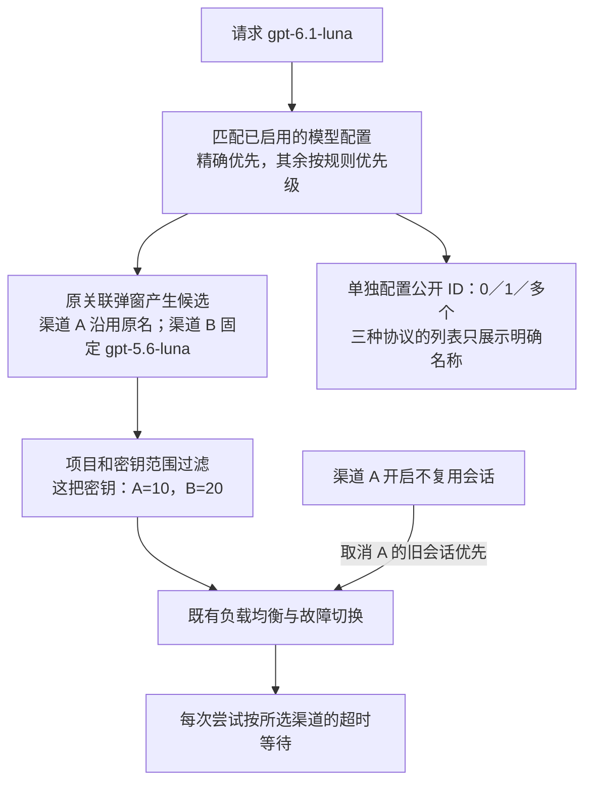
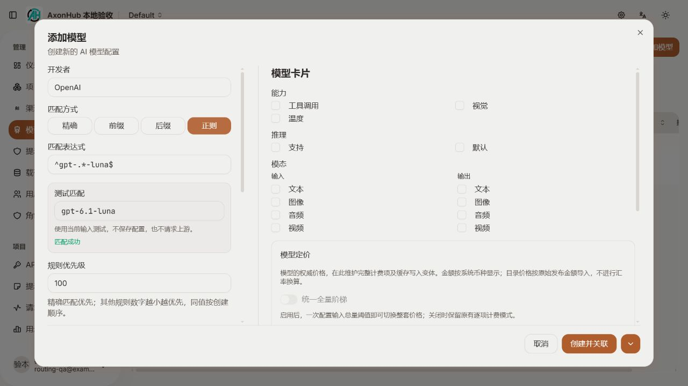
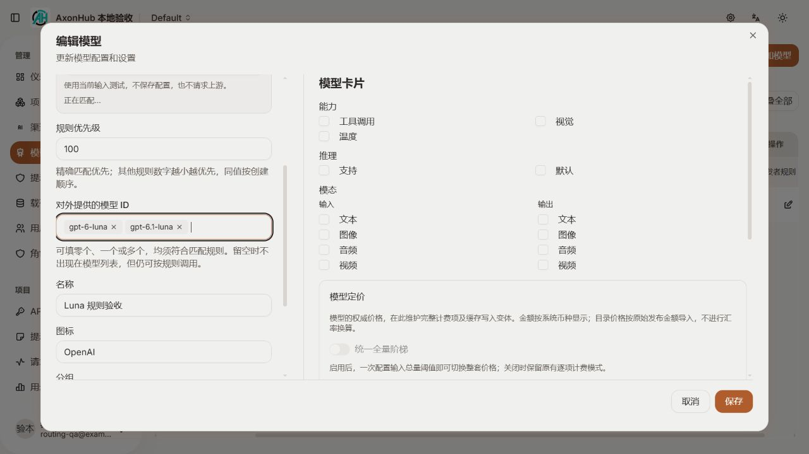
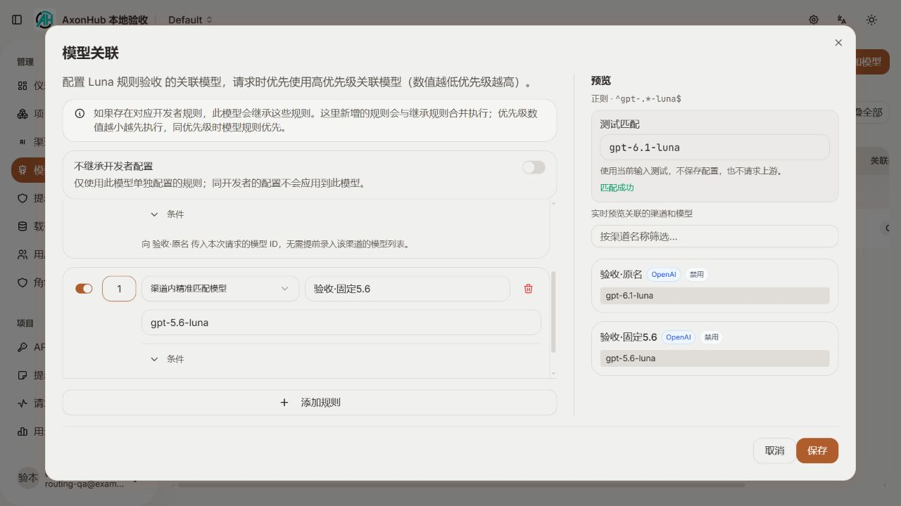
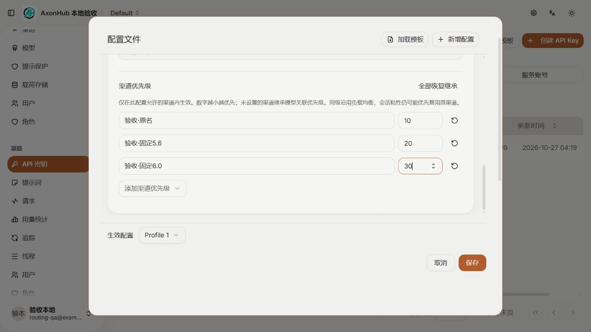
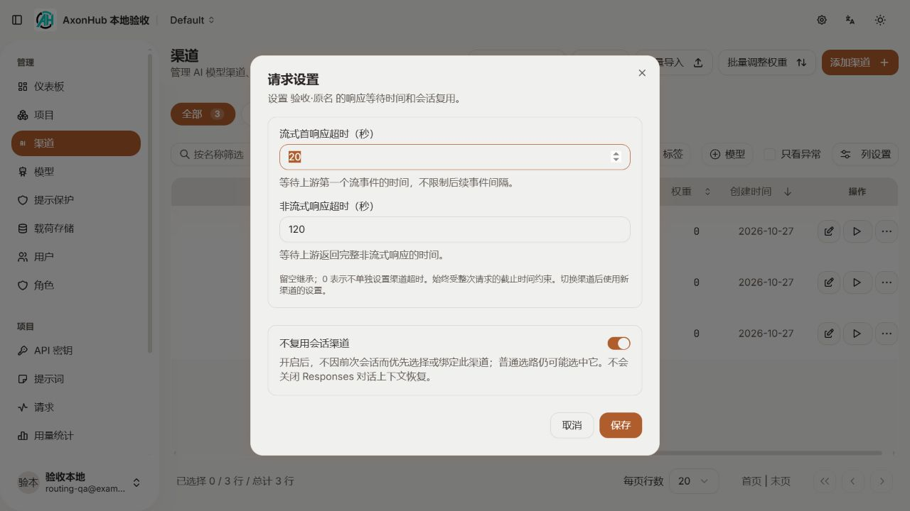

# 四项路由扩展：实现与验收

日期：2026-10-27。已在现有界面和路由流程上实现，未提交、未推送、未部署。

## 已实现的行为

| 位置 | 现在可以做什么 | 保留的边界 |
| --- | --- | --- |
| 添加／编辑模型 | 精确、字面前缀、字面后缀、正则；未保存规则即时测试；创建后直接关联 | 测试不请求供应商、不阻塞保存；精确优先，其余按优先级和 ID 选中一个配置 |
| 模型公开 ID 与关联 | 明确公开零／一／多个 ID；新关联可沿用请求名，也可继续指定固定上游模型 | 隐藏发现不等于禁用调用；不向公开列表返回表达式；原关联条件、开发者继承、负载均衡保留 |
| 密钥生效配置／模板 | 每把密钥单独设置渠道优先级，支持恢复继承和模板同步 | 不扩大允许渠道／标签范围，不改变全局渠道权重；同级沿用既有负载均衡 |
| 渠道行菜单“请求设置” | 流式首响应超时、非流式完整响应超时、不复用会话渠道 | 留空继承、0 取消该项渠道限制；每次尝试读取所选渠道设置；外层 deadline 仍生效 |

“不复用会话渠道”同时覆盖普通会话粘性和健康门控归属，不关闭 Responses 上下文恢复，也不保证每次一定换渠道。

下面是行为示意，不是真实供应商调用记录：

## 实际界面

以下截图来自隔离的本地测试数据库，页面运行本次前后端代码；没有修改线上配置。

### 模型入口与匹配测试

### 模型关联

### 密钥渠道优先级

### 渠道请求设置

## 关键文件

| 内容 | 实现文件 |
| --- | --- |
| 四种入口匹配的共同规则 | `internal/objects/model_match.go`（new）、`internal/ent/schema/model.go` |
| 规则选择、公开 ID、继承目录覆盖 | `internal/server/biz/model_routing.go`（new）、`internal/server/biz/model.go` |
| 动态渠道关联与缓存隔离 | `internal/server/biz/model_association_matcher.go`、`internal/server/orchestrator/candidates.go` |
| 密钥优先级 | `internal/server/orchestrator/candidates_priority.go`（new）、`internal/objects/apikey.go`、`internal/server/biz/api_key.go` |
| 渠道设置与每次尝试的超时 | `internal/server/biz/channel_request_settings.go`（new）、`internal/server/orchestrator/channel_request_settings.go`（new）、`llm/pipeline/pipeline.go` |
| 两条会话复用途径 | `internal/server/orchestrator/health_gate_selector.go`、`health_gate_session.go`、`candidates.go` |
| 模型匹配界面 | `frontend/src/features/models/components/models-match-fields.tsx`（new），接入原添加／关联弹窗 |
| 密钥优先级界面 | `frontend/src/features/apikeys/components/channel-priority-editor.tsx`（new），由密钥配置及两种模板弹窗共用 |
| 渠道请求设置界面 | `frontend/src/features/channels/components/channels-request-settings-dialog.tsx`（new），通过原行菜单打开 |
| 渠道查询字段选择 | `frontend/src/features/channels/data/channel-query-fields.ts`（new），从原数据文件移出静态选择常量，查询内容和调用方不变 |

Ent／GraphQL 生成代码、对应前端查询与 Zod schema、中英文文案已同步。无依赖版本或锁文件改动。
使用说明同步到 `docs/zh/guides/` 和 `docs/en/guides/` 的 `model-management.md`、`api-key-profiles.md`、`channel-management.md`；维护记录在 `docs/fork-maintenance.md`。

## 验证记录

| 命令／检查 | 结果 |
| --- | --- |
| `go generate`，工作目录 `internal/server/gql` | 通过；环境无 make，按 Makefile 的原生成命令执行，没有更换生成链 |
| `go test ./internal/objects ./internal/server/biz ./internal/server/orchestrator ./internal/server/gql ./internal/server/api` | objects、biz、gql、api 通过；完整检查发现既有会话归属时间戳问题，修正后单独重跑 orchestrator 通过 |
| `go test ./internal/server/orchestrator` | 最终通过，包含规则请求隔离、密钥并行隔离、会话归属和真实处理流水线的超时测试 |
| `go test ./pipeline`，工作目录 `llm` | 通过 |
| `npx --yes pnpm@10 test:unit`，工作目录 `frontend` | 103 项通过，0 失败 |
| `npx --yes pnpm@10 exec tsc --noEmit -p tsconfig.app.json` 与同一 TypeScript 编译器的 HEAD 基线对比 | 全量检查未通过。最终基线和当前均为 173 项诊断，未新增文件／错误类别位置；新组件无诊断。部分既有错误的展开类型文本随新增字段变化 |
| 三个新增 TSX 组件的 Prettier、手写 Go 的 gofmt | 已格式化 |
| `git diff --check` | 通过 |
| 本地浏览器，1280×720 | 四种匹配、非法表达式、创建并关联、多公开 ID、动态／固定关联保存通过；优先级 10／20／30 保存回读通过；模板发布后关联配置变为 5，独立配置保持 10；渠道设置 20／120／开启，以及 0／留空／关闭均保存回读正确；最后控制台无警告或错误 |

新增测试文件：

- `internal/objects/model_match_test.go`（new）
- `internal/server/biz/model_routing_test.go`（new）
- `internal/server/biz/model_routing_upgrade_test.go`（new）
- `internal/server/api/model_rules_test.go`（new）
- `internal/server/orchestrator/candidates_model_rules_test.go`（new）
- `internal/server/orchestrator/channel_request_settings_test.go`（new）
- `internal/server/orchestrator/channel_response_timeouts_test.go`（new）

另扩展了现有模板测试、静态缓存测试和会话归属回归用例。

## 验收中修正的问题

- 规则模型继承开发者配置时，旧的关联数量计算拿表达式去查具体模型，导致显示 0；现按渠道目录中匹配的具体 ID 计数，测试同时确认无关模型仍显示为未关联。
- 新增手动模型时，表单原有默认模型卡片缺少数组／容量默认值，导致创建被表单校验阻止；补齐已有字段默认值后，浏览器创建并关联通过。
- 健康门控同渠道快速重建归属时，两次 `time.Now()` 可能相同，旧请求晚完成可能误认新归属。新标识严格晚于保留的旧标识，续租仍保留原标识；回归测试覆盖时钟回退和晚完成请求。

## 升级与未验证范围

- 新增模型字段由既有 Ent 自动 schema 迁移处理；SQLite 已验证旧索引存在／缺失两种升级起点、旧精确模型仍公开原 ID、唯一索引改为匹配类型与表达式的组合，以及软删除后复用身份和名称。没有新增 data migration，也没有改动已发布迁移。
- MySQL／PostgreSQL 实库升级尚未验证。
- 没有向真实供应商发请求、没有线上部署；接口与选路验证使用本地数据库、HTTP 测试路由和模拟上游。
- 未运行 lint 或 build，遵循仓库限制。前端全量类型诊断是仍存在的项目基线问题。
- 本轮启动的 Vite、后端进程和浏览器测试页已关闭；临时数据库、日志和探针已通过受管清理删除，清理结果为 `cleaned=true`。预先存在的临时根目录未删除。设计预览与本报告中的实际截图属于交付产物，予以保留。

## 独立复审与自检

按要求由 `gpt-6.1-sol`、`max` 独立 subagent 审查；主执行者同步核对计划、规范和验证证据。
复审范围为当前四条主线及其直接调用方，不扩展到全库审计或生产部署。

最终结论：已确认目标均符合，发现的运行问题和规范缺口已修正并获独立复核，当前无未解决的阶段验收阻塞项。
可作为本地实现阶段完成验收；不把它等同于真实供应商或生产数据库的上线验收。

| 发现 | 处理与复核 |
| --- | --- |
| 同渠道不同模型合并后可能丢失第二模型的协议，导致重试发送到错误协议端点 | 独立探针稳定复现 `openai/responses` 被误用为 `anthropic/messages`；合并时同步复制、去重模型及协议数组。正式回归覆盖第二模型重试、健康门控裁剪和请求间隔离，原探针与正式用例均通过 |
| 升级测试未覆盖项目要求的旧索引缺失、软删除后身份复用 | 扩展原升级测试，使用真实软删除并验证旧行保留、新行可复用身份和名称；两种旧库起点均通过 |
| 渠道数据文件由存量 2245 行增至 2272 行，超过 2200 行约束 | 仅按字段选择职责移出 8 个静态 GraphQL 常量；原文件 2060 行、新文件 222 行。8 个模板和查询构造函数逐字等值，调用方与接口未变。既有源码断言同步读取新文件，103 项前端测试全部通过 |

修正后的命令与结果：

- `go test ./internal/server/biz -run '^TestModelRoutingSchemaUpgrade$' -count=1`：通过。
- `go test ./internal/server/orchestrator -run '^TestChannelPriority' -count=1`：通过。
- `go test ./internal/server/orchestrator ./internal/server/biz`：两个整包通过。
- `npx --yes pnpm@10 test:unit`：103 项通过。
- `npx --yes pnpm@10 exec tsc --noEmit -p tsconfig.app.json`：仍为 173 项既有诊断；新查询常量模块没有诊断，不能把全量类型检查记作通过。
- 独立审查者另行复跑匹配、路由、公开 API、优先级、超时、禁复用、模板、会话归属及 `llm` 流水线测试，均通过；未重复浏览器交互。
- 最后规范复核：独立审查者确认查询抽离等值，单独运行 `node --test src/features/channels/data/channel-config.test.mjs`，9 项通过。本轮改动的手写源码均不超过 2200 行；生成代码按项目生成规则维护。

新增的查询文件拆分仅用于本阶段触及文件的规范收尾，不改变设计、权限、依赖、供应商路线或部署状态。
独立审查者的临时验证目录已按受管流程删除，返回 `cleaned=true`；最后一轮常量拆分复核未创建临时产物。

### 修复范围的再次复审

再次由同一独立审查者定向复核，仅检查协议数组合并、升级测试补齐、查询常量抽离及各自直接调用方。
协议修复覆盖第二模型重试、去重、健康门控裁剪和请求间隔离；升级用例真实覆盖两种旧索引状态及软删除复用；
查询常量内容、导入导出、构造函数和原测试断言保持一致。三处均未发现新问题、直接回归或具体覆盖缺口。

本次复用与当前内容一致的已通过定向 Go 测试、独立协议探针和 9 项渠道配置测试，未重跑整包或全套测试，
未重新审查已确认无问题的其他功能，也未修改业务源码或创建临时产物。结论仅针对上述修复范围，原验收边界不变。
